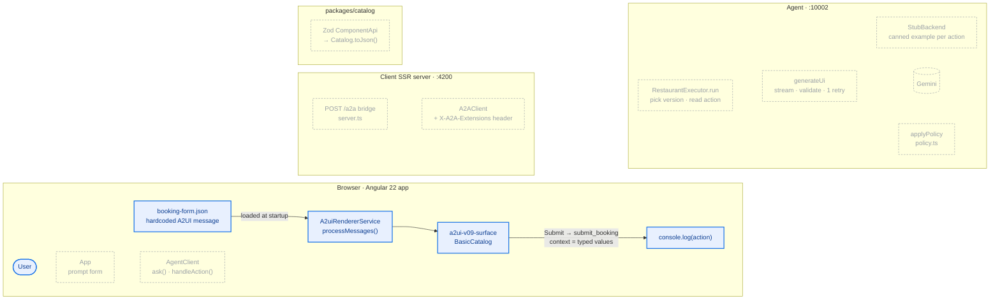
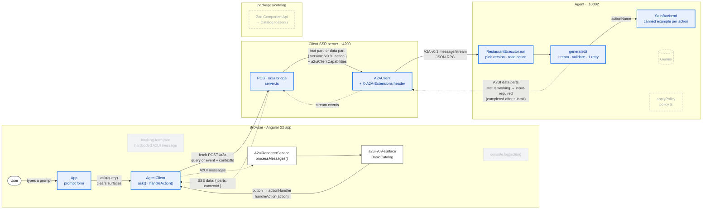
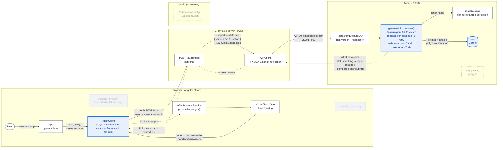
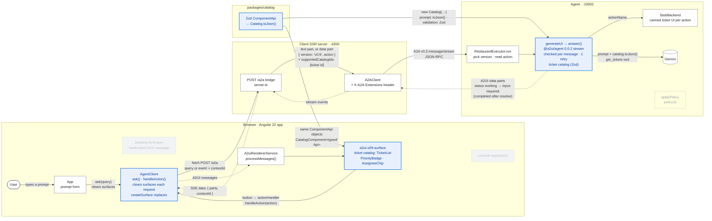

# Demo flow, phase by phase

One diagram per implementation phase, so the demo's growth can be followed (and, later, shown on
stage) as a sequence of frames. Status per phase lives in `README.md`; this file only draws it.

**Rules that keep the frames a transition, not a set of unrelated pictures:**

- Every frame draws **the same nodes, with the same ids, in the same order**, plus the same edges in
  the same order. Nothing is added or dropped between frames: a node or edge only changes status.
- Status is a class: `todo` (dashed, grey: not built yet), `new` (highlighted: added in this phase),
  `done` (plain: carried over), `gone` (faded: replaced in this phase or earlier).
- An edge that does not exist yet (or any more) is written `~~~`, an invisible link, so the layout
  does not move when it appears. Solid arrows are requests, dotted arrows are what comes back.
- A new phase copies the previous frame, flips the classes and arrows that changed, and adds any new
  node to **every** earlier frame as `todo`.

## Phase 1 — render without an agent (done 2026-10-22)

The renderer is fed one hardcoded A2UI v0.9 message (the booking form from the official Node agent
sample). Clicking *Submit Reservation* fires a `submit_booking` action that is only logged.

## Phase 2 — the full chain in stub mode (done 2026-10-22)

The browser never speaks A2A: it POSTs to its own server, which is the A2A client. The agent runs
with `STUB_LLM=true`, so no model is called: it picks a canned example by action name (no action →
restaurant list, `book_restaurant` → booking form, `submit_booking` → confirmation), prefixes a
stub-notice surface, and streams it in four chunks. Each UI action goes back through the same path
as a `{ version: 'v0.9', action }` data part; the conversation is held together by `contextId`.

## Phase 3 — live model (done 2026-10-31)

`GEMINI_API_KEY` set, so `generateUi` calls Gemini (`gemini-3.6-flash`), which calls the
`get_restaurants` tool and streams A2UI back; `StubBackend` stays as the fallback when
`STUB_LLM=true`. Two fixes landed with it (`README.md` → "Incidents"): `@a2ui/agent` 0.0.1 → 0.0.2,
so the client now clears surfaces on every request; and the agent validates with `@a2ui/web_core`'s
Zod `basicCatalog`, the one the renderer uses, so a binding cut mid-stream is held back.

## Phase 4 — Zod catalog + ticket domain (done 2026-11-06) ← current

`packages/catalog` defines the ticket catalog once, as Zod 3 `ComponentApi`s (`TicketList`,
`PriorityBadge`, `AssigneeChip` plus the basic `Text`/`Row`/`Column`/`Card`/`Divider`/`Button`),
assembled with `new Catalog(id, 'v0.9', …)`. The agent registers that `Catalog`: the prompt
carries its `toJson()` document, validation runs on its Zod. The Angular components are typed and
registered with the same `ComponentApi` objects, and `server.ts` advertises only the ticket
catalog id. Restaurants are gone: `get_tickets` tool, ticket examples, `open_ticket` /
`resolve_ticket`. A prop outside the catalog fails validation and is retried once; `AgentClient`
now lets a retry's `createSurface` replace the surface the failed attempt streamed.

**Next frames** (planned; `POL` and `CAT` were added to every frame as `todo` on 2026-10-23, so the
layout won't move when they land):

- **Policy:** `POL` becomes `new`; `GEN → AX` turns into `GEN → POL → AX` (the old direct edge goes
  `~~~`). Policy runs in `answer()` on every published message (streamed and non-streamed path),
  before `toA2aParts`.
- **Transport swap:** `server.ts` unwraps A2A, so `BR -.-> AC` is relabelled from
  "SSE data: { parts, contextId }" to plain A2UI messages + session id, and `AC` loses its A2A
  field names. No node changes; this is the frame that shows only the adapter moved.
