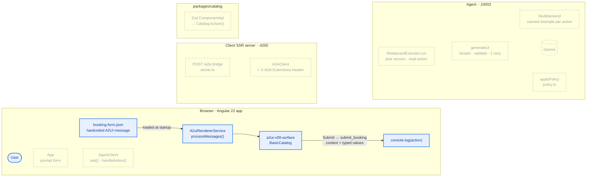
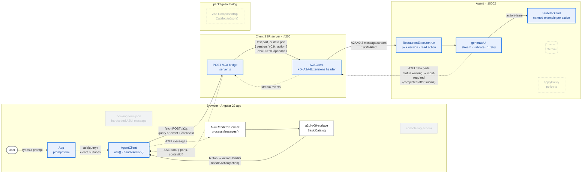

# Demo flow, phase by phase

One diagram per implementation phase, so the demo's growth can be followed (and, later, shown on
stage) as a sequence of frames. Status per phase lives in `README.md`; this file only draws it.

**Rules that keep the frames a transition, not a set of unrelated pictures:**

- Every frame draws **the same nodes, with the same ids, in the same order**, plus the same edges in
  the same order. Nothing is added or dropped between frames: a node or edge only changes status.
- Status is a class: `todo` (dashed, grey: not built yet), `new` (highlighted: added in this phase),
  `done` (plain: carried over), `gone` (faded: replaced in this phase or earlier).
- An edge that does not exist yet (or any more) is written `~~~`, an invisible link, so the layout
  does not move when it appears. Solid arrows are requests, dotted arrows are what comes back.
- A new phase copies the previous frame, flips the classes and arrows that changed, and adds any new
  node to **every** earlier frame as `todo`.

## Phase 1 — render without an agent (done 2026-10-22)

The renderer is fed one hardcoded A2UI v0.9 message (the booking form from the official Node agent
sample). Clicking *Submit Reservation* fires a `submit_booking` action that is only logged.

## Phase 2 — the full chain in stub mode (done 2026-10-22) ← current

The browser never speaks A2A: it POSTs to its own server, which is the A2A client. The agent runs
with `STUB_LLM=true`, so no model is called: it picks a canned example by action name (no action →
restaurant list, `book_restaurant` → booking form, `submit_booking` → confirmation), prefixes a
stub-notice surface, and streams it in four chunks. Each UI action goes back through the same path
as a `{ version: 'v0.9', action }` data part; the conversation is held together by `contextId`.

**Next frames** (planned; `POL` and `CAT` were added to every frame as `todo` on 2026-10-23, so the
layout won't move when they land):

- **Phase 3, live model:** `LLM` becomes `new`, `GEN ~~~ LLM` becomes a real edge, and `STUB` stays
  as the fallback used when `STUB_LLM=true`.
- **Zod catalog + custom components:** `CAT` becomes `new`; `CAT ~~~ GEN` becomes "catalog JSON
  (`InMemoryCatalogProvider`)" and `CAT ~~~ S` becomes "same `ComponentApi`s"; `S` is relabelled
  from `BasicCatalog` to the ticket catalog. See `IMPLEMENTATION-PLAN.md` → "Zod catalog and policy
  on top of `@a2ui/agent`".
- **Policy:** `POL` becomes `new`; `GEN → AX` turns into `GEN → POL → AX` (the old direct edge goes
  `~~~`). Policy runs on the streamed and the validated path, before `toA2aParts`.
- **Transport swap:** `server.ts` unwraps A2A, so `BR -.-> AC` is relabelled from
  "SSE data: { parts, contextId }" to plain A2UI messages + session id, and `AC` loses its A2A
  field names. No node changes; this is the frame that shows only the adapter moved.
