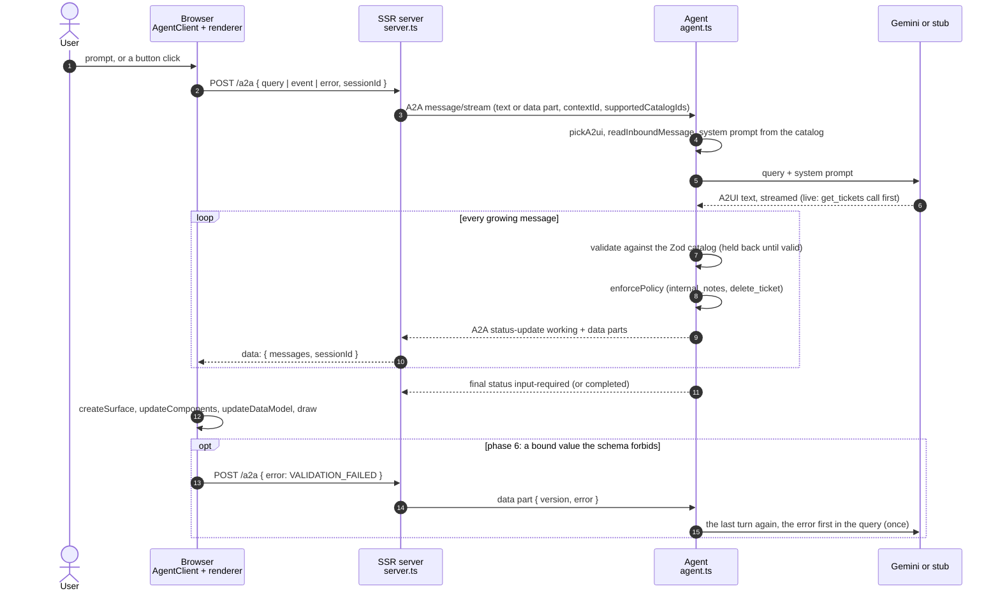
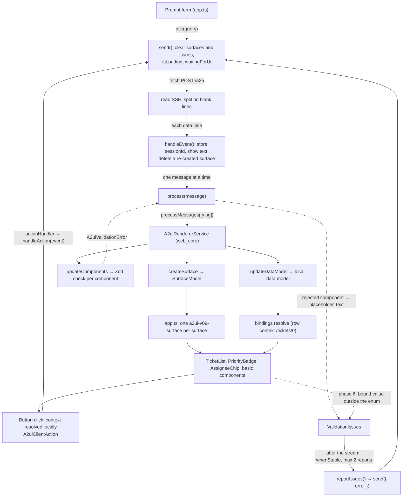
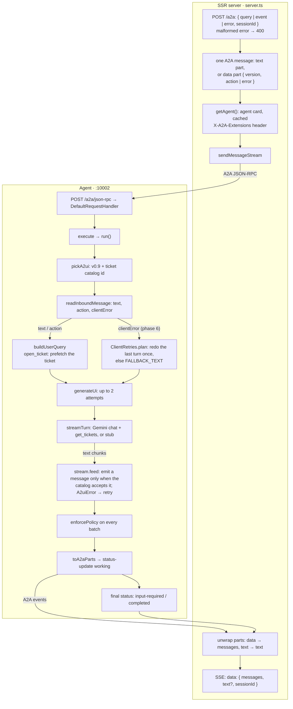

# Data flow

What happens to one request in the demo, step by step, and the exact data at every boundary.
Read this before the code: every step names the file it lives in.

There are two ways to read it:

- **This page.** Three diagrams (end to end, frontend, backend), then the payloads.
- **The interactive map:** [`index.html`](index.html). Open it in a browser, from a clone or with any static
  server (`python3 -m http.server` in this folder). It has the same three views as tabs, with guided
  walks, and each node shows its file and the exact payload. It needs the cytoscape CDN.

The flow below is the demo with phase 6 (renderer → agent `VALIDATION_FAILED`, PR #8). Phase-6 steps
are marked **(phase 6)**.

## What runs where

| Process | Port | Code | Talks to |
|---|---|---|---|
| **Browser**, the Angular 22 app | – | `apps/client/src/app/` | its own server only: `POST /a2a`, reply as SSE |
| **SSR server**, Express from `@angular/ssr` | 4200 (`npm run start:client`), 4000 (built) | `apps/client/src/server.ts` | the agent, over A2A |
| **Agent**, Node + `@a2ui/agent` 0.0.2 | 10002 | `apps/agent/src/` | Gemini (`gemini-3.6-flash`) or the stub |

The SSR server renders no pages here (every route is `RenderMode.Client` in `app.routes.server.ts`):
it is the bridge. The browser never speaks A2A, never sees the agent's URL, and holds no key.
`server.ts` is the only file that knows A2A, so changing the transport means rewriting that one file.

Three names for the same conversation: the browser's `sessionId` is sent as A2A `contextId`, and the
agent keys its Gemini chat and its client-retry memory by it.

## 1. End to end: one turn



If validation fails inside the agent, it retries once with the error in the query (`MAX_ATTEMPTS = 2`)
and sends a text apology if the retry fails too. Nothing invalid leaves the agent; what it already
published stays on screen until the retry's `createSurface` replaces it.

## 2. Frontend: inside the browser



- `send()` deletes every surface first: each reply carries its whole UI, `createSurface` included.
  A phase-6 report keeps the old surfaces until the corrected reply's first messages arrive.
- web_core rejects a whole `updateComponents` if one component fails. `process()` then applies the
  components one by one and replaces each rejected one with a placeholder `Text` (same id), so the rest
  renders **(phase 6)**.
- web_core checks components, not the values their bindings resolve to. `PriorityBadge` checks its
  resolved `priority` against the catalog's own Zod (`resolved-value.ts`) **(phase 6)**.
- Typing into an input only writes the local data model. Only a button action goes back.

## 3. Backend: SSR server and agent



- **Negotiation.** Only catalog ids travel. The model reads the catalog as JSON Schema from
  `ticketCatalog.toJson()` in its system prompt; validation uses the Zod objects themselves
  (`packages/catalog`), the same ones the Angular client registers.
- **Model.** One Gemini chat per `contextId` + version, thinking `MINIMAL` by default. A free-text
  request is usually two calls: the first returns a `get_tickets` call, the second writes the UI.
  `open_ticket` skips the first: the agent fetches the ticket itself.
- **Validation while streaming.** `@a2ui/agent`'s Direct JSON stream re-sends a message whole each
  time it grows, and only when a fresh renderer state accepts it.
- **Policy.** `DEMO_POLICY` forbids `/tickets/*/internal_notes` and `/ticket/internal_notes` and
  disables `delete_ticket`. It runs on every re-send, because each one reaches the browser.
- **Errors.** A model or network error (e.g. a Gemini 503) retries the original query; an A2UI error
  retries with the error. Any exception ends the task with a `failed` status and a text part.

## Payloads at each boundary

**Browser → SSR server**, `POST /a2a` (one of `query`, `event`, `error`):

```json
{ "query": "Show me the open tickets", "sessionId": "…" }

{ "event": { "name": "open_ticket", "surfaceId": "tickets", "sourceComponentId": "open_button",
             "timestamp": "2026-11-13T10:00:00.000Z", "context": { "ticketId": "TCK-1042" } },
  "sessionId": "…" }

{ "error": { "code": "VALIDATION_FAILED", "surfaceId": "tickets", "path": "/tickets/0/priority",
             "message": "PriorityBadge (ticket_priority): priority resolved to \"critical\" from /tickets/0/priority, …" },
  "sessionId": "…" }
```

**SSR server → agent**, A2A `message/stream` to the URL in the agent card
(`http://localhost:10002/a2a/json-rpc`), header `X-A2A-Extensions: https://a2ui.org/a2a-extension/a2ui/v0.9`:

```json
{ "message": {
    "kind": "message", "messageId": "<uuid>", "role": "user", "contextId": "<sessionId>",
    "parts": [ { "kind": "text", "text": "Show me the open tickets" } ],
    "metadata": { "a2uiClientCapabilities": { "v0.9": {
      "supportedCatalogIds": [ "https://github.com/giorgiogalassi/talk-a2ui/demo/catalogs/tickets/v0_9/catalog.json" ] } } } } }
```

An action or an error is a data part instead:
`{ "kind": "data", "data": { "version": "v0.9", "action": { … } }, "metadata": { "mimeType": "application/a2ui+json" } }`
(or `"error": { … }`).

**Agent → SSR server**, A2A events: the `Task` (first turn), then status updates. One data part per
A2UI message:

```json
{ "kind": "status-update", "taskId": "…", "contextId": "…", "final": false,
  "status": { "state": "working", "timestamp": "…",
    "message": { "kind": "message", "role": "agent", "messageId": "…", "parts": [
      { "kind": "data", "data": { "version": "v0.9", "updateComponents": { "surfaceId": "tickets", "components": [ … ] } },
        "metadata": { "mimeType": "application/a2ui+json" } } ] } } }
```

The last event has `"final": true` and state `input-required` (`completed` after `resolve_ticket`),
with no parts if they were already published. A fallback is a text part.

**SSR server → browser**, SSE, one line per A2A event:

```text
data: {"messages":[{"version":"v0.9","createSurface":{"surfaceId":"tickets","catalogId":"…/tickets/v0_9/catalog.json"}}, …],"sessionId":"…"}

data: {"messages":[],"text":"I'm sorry, I'm having trouble generating the interface for that request right now. Please try again in a moment.","sessionId":"…"}
```

If the agent can't be reached before the stream starts, the server answers `502 { "error": "…" }`;
after it started, `data: {"error":"…"}` and the stream ends.

**The A2UI messages themselves** (from `apps/agent/examples/v0.9/ticket_list.json`):

```json
{ "version": "v0.9", "createSurface": { "surfaceId": "tickets", "catalogId": "…/tickets/v0_9/catalog.json" } }
{ "version": "v0.9", "updateComponents": { "surfaceId": "tickets", "components": [
  { "id": "root", "component": "TicketList", "title": { "path": "/title" },
    "children": { "componentId": "ticket_row", "path": "/tickets" } },
  { "id": "ticket_priority", "component": "PriorityBadge", "priority": { "path": "priority" } },
  { "id": "open_button", "component": "Button", "child": "open_text",
    "action": { "event": { "name": "open_ticket", "context": { "ticketId": { "path": "id" } } } } } ] } }
{ "version": "v0.9", "updateDataModel": { "surfaceId": "tickets", "path": "/",
  "value": { "title": "Open tickets", "tickets": [ { "id": "TCK-1042", "priority": "urgent", "assignee": "Giulia Rossi" } ] } } }
```

(Trimmed: the real list has more components and tickets.)

## Keeping this up to date

`graph.json` is the source of the interactive map. After changing it, run `python3 build.py` here:
it checks every edge and walk, then writes `index.html` from `template.html`. Update this page in the
same change.
