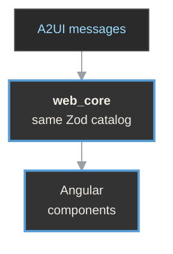
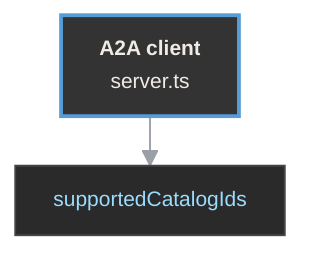
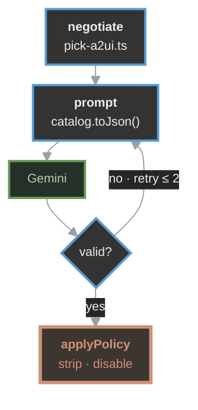

<div class="ta">
  <div class="ta-hero">
    <FitText :weight="300" :wdth="100" class="ta-dim">Your AI should not</FitText>
    <FitText :weight="900" :wdth="100" class="ta-accent">generate HTML.</FitText>
  </div>
  <div class="ta-foot">
    <div><b>Angular + A2UI</b><span>structured generative UI</span></div>
    <div><b>AngularDay 2026</b><span>Verona · 20 November</span></div>
    <div><b>Giorgio Galassi</b><span>ggalassi.dev</span></div>
  </div>
</div>

<!--
Speaker notes:
Welcome the room. No preamble needed.
Let the title sit for a second before moving on.
This is an Advanced-level talk, 40 minutes with a live demo (pre-recorded fallback ready).
Do not open with a broken React component or a horror-story HTML injection screenshot.
That framing is wrong and the audience will know it immediately — no serious team ships
raw LLM-generated HTML to production. Starting there feels like finding a problem for
a solution. Go straight into the real problem instead.
-->

---
rule: ['Part 1', 'The Problem']
---

<div class="ta">
  <div class="ta-hero">
    <FitText :weight="900" :wdth="90">The Problem.</FitText>
  </div>
</div>

<!--
~5 minutes.
-->

---
rule: ['The Problem', 'Part 1']
---

# Agents are already in production

They handle complex tasks. They call tools. They manage multi-step workflows.

And the moment they need to respond with something richer than text, they hit a wall.

<!--
Speaker notes:
This is the actual opening line. Say it plainly, no dramatization.
The problem is not bad code quality. Not developer tooling.
It's agents that need to hand something visual and interactive back to a user,
in a system they do not fully control.
Pause after "they hit a wall" — let that land before moving to the quote.
-->

---
rule: ['The Problem', 'Part 1']
---

# Google says it plainly

> "Generative AI excels at creating text and code, but agents can struggle to present
> rich, interactive interfaces to users, especially when those agents are remote or
> running across trust boundaries."

<div class="text-sm text-gray-400">

Source: [github.com/google/A2UI — Summary](https://github.com/google/A2UI#summary)

</div>

<!--
Speaker notes:
Ground the problem in Google's own framing from the A2UI README before offering
your own take. This isn't me inventing a problem — Google's own team building this
standard describes it the same way.
Read the quote slowly. "Trust boundary" is the phrase to let land — that's the
crux of the whole talk. Not "agents write bad UI." Agents that are remote,
that you don't fully control, that need to hand back something interactive.
-->

---
rule: ['The Problem', 'Part 1']
---

# What the agent's options look like today

**Option 1 — Generate HTML or JSX and inject it**
Unbounded output, no contract, no validation surface. By the time it renders,
it's too late to check. Across a trust boundary, you're executing arbitrary code
from a remote agent in your client application.

<!--
Speaker notes:
Walk through the three options one at a time, don't rush.
Option 1 is the one everyone's instinct jumps to because it's what a browser-based
coding agent already does locally, in a sandbox you control. The moment the agent
is remote — a different service, a different trust domain — this stops being safe.
There's no way to inspect what you're about to execute before you execute it.
-->

---
rule: ['The Problem', 'Part 1']
---

# Option 2 — return data, let the frontend render it

Clean. Predictable. And now the agent has no voice in how its output is presented.

It cannot say "show this as an approval workflow."
It cannot say "this data needs a date picker."

The agent is reduced to a JSON API with no say in presentation.

<!--
Speaker notes:
This is the safe-but-limited option. Most teams that get nervous about option 1
land here by default. It's not wrong, it's just incomplete — you've solved safety
by removing the agent's ability to express intent about presentation at all.
The dashboard demo later in the talk is specifically the case where this breaks:
the agent needs to choose the shape of the response, not just supply values.
-->

---
rule: ['The Problem', 'Part 1']
---

# Option 3 — nothing

The agent responds in plain text.

The interactive experience is lost entirely.

<!--
Speaker notes:
Quick beat, don't over-explain. This is the fallback most teams actually ship
when they hit the wall — chat-only, no rich UI at all, because option 1 is unsafe
and option 2 doesn't cover the intent the agent needs to express.
-->

---
rule: ['The Problem', 'Part 1']
---

# What if there was a fourth option?

What if the agent could describe *what* it wants to show, and the frontend could
decide *how* to show it — safely, within bounds it controls?

<div class="callout">

That question is what A2UI answers.

</div>

<!--
Speaker notes:
Deliver this as a genuine question, then pause before the callout line.
This is the hinge of the whole talk — everything after this slide is the answer.
-->

---
rule: ['Part 2', 'The Paradigm Shift']
---

<div class="ta">
  <div class="ta-hero">
    <FitText :weight="900" :wdth="90">The Paradigm Shift.</FitText>
  </div>
</div>

<!--
~5 minutes.
-->

---
rule: ['The Paradigm Shift', 'Part 2']
---

# The LLM becomes a planner and composer, not a code generator

<!--
Speaker notes:
State this clearly and let it sit as its own slide before backing it with evidence.
This single sentence is the reframe the rest of the talk builds on.
-->

---
rule: ['The Paradigm Shift', 'Part 2']
---

# This is not hypothetical

Google has published A2UI as an open-source standard — currently **v0.9**,
**13k+ GitHub stars** — specifically designed to let agents "speak UI" through
a declarative JSON format rather than generating executable code.

<!--
Speaker notes:
Ground the shift immediately in reality, don't let it float as a concept.
This is a real, actively maintained standard with real adoption signal, not
a one-off research idea. That's worth saying explicitly for a room of engineers
who are going to ask "is this vaporware."
-->

---
rule: ['The Paradigm Shift', 'Part 2']
---

# The core diagram

```
User Intent → LLM → A2UI JSON → Renderer → Native UI
```

<!--
Speaker notes:
Walk left to right slowly. User intent goes into the LLM. The LLM's only output
is A2UI JSON — never markup, never executable code. The renderer — the Angular
app — turns that JSON into native UI using components it already trusts.
Hold here, because the next slide is the objection this diagram immediately raises.
-->

---
rule: ['The Paradigm Shift', 'Part 2']
---

# "Why is AI-generated JSON safer than AI-generated HTML?"

<!--
Speaker notes:
Say this as the question the audience is already forming. Don't answer immediately —
let it hang for a beat, then move to the next slide for the actual answer.
This is the objection-handling moment of the talk. If you skip it, the room
mentally checks out for the rest of the technical sections.
-->

---
rule: ['The Paradigm Shift', 'Part 2']
---

# The real argument

A2UI is a **declarative data format**, not executable code.

The client maintains a catalog of trusted, pre-approved components.
The agent can only request components from that catalog.

<div class="callout">

HTML has infinite surface area. A2UI has an enumerable, allowlisted one.

</div>

<!--
Speaker notes:
This is the answer, and it's the sentence to get exactly right: "HTML has infinite
surface area. A2UI has an enumerable, allowlisted one." Say it slowly.
JSON isn't safe because it's JSON — plenty of JSON-based attacks exist.
It's safe here specifically because the vocabulary the agent can use is closed
and known in advance. That's the actual mechanism, not a vibe about data vs. code.
-->

---
rule: ['The Paradigm Shift', 'Part 2']
---

# Acknowledge maturity, up front

A2UI is **v0.9**. The spec is still evolving toward v1.0.

What you're learning today is the pattern and the architecture —
not a production dependency.

<div class="text-sm text-gray-400">

The specific library will stabilize. The renderer contract pattern will not change.

</div>

<!--
Speaker notes:
Say this honestly and don't rush past it. An advanced audience will respect you
more for naming the maturity level than for overselling it.
The point to land: even if the `@a2ui/*` packages look different in a year,
the shape of the problem — catalog, capability negotiation, validation at the
boundary — is stable regardless of which library implements it. That's what
they should walk away holding onto.
-->

---
rule: ['Part 3', 'Where This Actually Makes Sense']
---

<div class="ta">
  <div class="ta-hero">
    <FitText :weight="900" :wdth="90">Where This Actually</FitText>
    <FitText :weight="900" :wdth="90">Makes Sense.</FitText>
  </div>
</div>

<!--
~5 minutes. Needs a dedicated slide per use case, plus a "when NOT to use this"
closing slide — do not skip it. The audience will ask "when would I actually
build this?" before buying into the architecture in section 4 and 5.
-->

---
rule: ['Where This Actually Makes Sense', 'Part 3']
---

# Enterprise internal tooling at scale

Platforms like Salesforce, ServiceNow, or SAP serve thousands of customers,
each with different data models, roles, and workflows.

Today: configuration systems — low-code UI builders made of JSON config,
feature flags, conditional rendering logic.

**A2UI replaces the configuration layer** with an agent that reads the
customer's data model and composes the appropriate surface on demand.

<!--
Speaker notes:
The policy enforcement layer maps directly onto the per-customer access
restrictions these platforms already have to enforce today. You're not adding
a new security model — you're moving an existing one to sit in front of
generation instead of behind it.
-->

---
rule: ['Where This Actually Makes Sense', 'Part 3']
---

# Financial services dashboards

Analysts ask highly specific questions:
*"show me exposure across these five positions with this risk metric,
broken down by region."*

The answer is always a different surface.

Today: either a huge library of pre-built views, or a custom dashboard per request.

<!--
Speaker notes:
An agent composing from a validated catalog of financial components is strictly
safer than one generating arbitrary HTML, and it maps cleanly onto compliance
requirements around what data specific roles are allowed to see — the catalog
and the role-based policy layer are doing the same enforcement job.
-->

---
rule: ['Where This Actually Makes Sense', 'Part 3']
---

# Healthcare and clinical decision support

A cardiologist's workflow looks nothing like an oncologist's — and both change
depending on the specific patient's data.

Dynamic composition from a **safe, auditable component catalog** fits the
regulatory requirement that every rendered element be traceable and controllable.

<div class="text-sm text-gray-400">

Arbitrary HTML generation would never pass a compliance review.

</div>

<!--
Speaker notes:
A2UI gives the flexibility of dynamic composition with the auditability
healthcare demands. The catalog is what makes a compliance review possible
at all — you can point to the exact enumerable set of things that could
ever have been rendered, for any payload, at any time.
-->

---
rule: ['Where This Actually Makes Sense', 'Part 3']
---

# Remote sub-agents in an orchestrator

A parent agent delegates a task to a specialized sub-agent —
a booking agent, a reporting agent.

The sub-agent returns an A2UI payload.
The parent renders it inline **without knowing its structure in advance**.

<div class="callout">

The catalog defines the contract both agents work within.

</div>

<!--
Speaker notes:
This is the multi-agent case, and it's worth calling out separately because it's
the one that generalizes furthest. The parent doesn't need to know anything about
the sub-agent's internals — the shared catalog is the entire interface between them.
-->

---
rule: ['Where This Actually Makes Sense', 'Part 3']
---

# Why the standard approach breaks down

Hardcoded components with conditional rendering work well when the number of
possible UI states is enumerable and stable. They break down when:

- **The combinations explode** — 50 data dimensions × 10 roles is not 500 templates,
  it's a composition system you're building anyway
- **The interface responds to data you don't control** — enterprise customers bring
  their own schemas, clinical data varies per patient
- **Maintenance cost compounds** — every new template is a liability

<!--
Speaker notes:
Teams that build large configuration-driven UI systems eventually reinvent
something close to what A2UI formalizes — without the protocol, without the
validation layer, and without the capability negotiation. That's the honest
pitch: you're already halfway to building this. A2UI just names the pattern
and gives it a validation boundary.
-->

---
rule: ['Where This Actually Makes Sense', 'Part 3']
---

# When NOT to use this

For a product with a fixed, well-understood user journey — a checkout flow,
a settings page, a login screen — **this is unnecessary complexity**.

<div class="callout">

If you can enumerate the states, enumerate them.

</div>

The paradigm earns its overhead when the interface is a function of data and
context that varies at runtime in ways you can't fully anticipate at build time.

<!--
Speaker notes:
This slide is not optional — it's the credibility slide. An advanced audience
trusts a speaker more, not less, for drawing the boundary of where their own
architecture doesn't apply. Say it plainly and don't hedge it.
-->

---
rule: ['Part 4', 'Anatomy of an A2UI System']
---

<div class="ta">
  <div class="ta-hero">
    <FitText :weight="900" :wdth="90">Anatomy of an</FitText>
    <FitText :weight="900" :wdth="90">A2UI System.</FitText>
  </div>
</div>

<!--
~10 minutes. This is the technical core.
-->

---
rule: ['Anatomy of an A2UI System', 'Part 4']
---

# The full pipeline

<div class="dg">
<div class="dg-lane">
<div class="dg-label">// browser</div>



</div>
<div class="dg-wire">
  <span>POST /a2a ----></span>
  <span><---- SSE</span>
  <span class="dg-planned">VALIDATION_FAILED ----></span>
</div>
<div class="dg-lane">
<div class="dg-label">// ssr server</div>



</div>
<div class="dg-wire">
  <span>A2A ----></span>
  <span><---- A2A stream</span>
</div>
<div class="dg-lane dg-wide">
<div class="dg-label">// agent · @a2ui/agent</div>



</div>
</div>


---
rule: ['Anatomy of an A2UI System', 'Part 4']
---

# Zod is not your addition — it's built into A2UI

Every catalog component is a Zod schema (`ComponentApi`): its allowed properties
and types. One definition, shared by both ends.

**Agent** — writes the catalog into the prompt as JSON Schema (`catalog.toJson()`)
and validates every reply against the same Zod, before anything is sent.

**Renderer** — registers its Angular components with the same objects and checks
every message again on arrival.

**The wire** — carries only catalog IDs (`supportedCatalogIds`). The protocol
can also send a catalog inline; the demo doesn't need to.

<div class="text-sm text-gray-400">

Source: [catalog/types.ts#L172-L183](https://github.com/google/A2UI/blob/0af1b1e7/renderers/web_core/src/v0_9/catalog/types.ts#L172-L183) ·
[client-capabilities.ts#L15-L30](https://github.com/google/A2UI/blob/0af1b1e7/renderers/web_core/src/v0_9/schema/client-capabilities.ts#L15-L30) ·
demo: `packages/catalog`

</div>

<!--
Speaker notes:
This is the point that connects directly back to the "Kneel Before Zod" material
for anyone who's seen that talk — Zod shows up here in a completely different
role than runtime validation of form input.
In the demo, packages/catalog is imported by both the agent and the Angular app:
the same ComponentApi objects. The browser (through our server) only says which
catalog it speaks; the agent already holds the schema.
The agent is constrained upfront: it cannot even attempt to use components or
property values outside the schema, because it never sees them as options in
the first place. And if the model drifts anyway, the agent's own validation
catches it before the user does.
-->

---
rule: ['Anatomy of an A2UI System', 'Part 4']
---

# Zod defines what the agent is allowed to think

For an audience that already knows Zod from runtime validation, this is the
reframe:

<div class="callout">

Here, Zod isn't the validation layer you bolt on. It's the schema language
the entire agent-client contract is written in.

</div>

<!--
Speaker notes:
Let this slide breathe — it's a short, dense idea and it lands better slow.
This is the sentence people should be quoting after the talk.
-->

---
rule: ['Anatomy of an A2UI System', 'Part 4']
---

# Validation ownership — who checks what, where

**Client-side** (`web_core`): capability negotiation and catalog schema validation.

**Your application policy layer** — forbidden fields, forbidden actions,
role restrictions — is what *you* add, and it belongs **server-side**,
before the payload reaches the client.

<div class="text-sm text-gray-400">

Source: [samples/client/angular/README.md#L54-L61](https://github.com/google/A2UI/blob/0af1b1e7/samples/client/angular/README.md#L54-L61)

</div>

<!--
Speaker notes:
This is a distinction people will ask about in Q&A if you don't make it explicit
now: A2UI's own validation checks structure and type against the catalog. It has
no idea about your business rules — which role can see which field, which action
is disabled for which customer tier. That's a layer you build, and it has to sit
server-side, before the payload ever reaches the browser, or a client-side bypass
defeats the whole point.
-->

---
rule: ['Anatomy of an A2UI System', 'Part 4']
---

# The component registry is the trust boundary

The agent can only compose from what exists in the catalog.

It cannot invent. It cannot escape.

Unknown component types are rejected before reaching the renderer.

<!--
Speaker notes:
Say this plainly, it's the summary of everything in this section.
This is the sentence to return to if anyone in Q&A asks "but what if the agent
tries something malicious" — the answer is always the same: it structurally
cannot reference anything outside the catalog, full stop.
-->

---
rule: ['Anatomy of an A2UI System', 'Part 4']
---

# A2UI is not AI magic

<div class="callout">

It's a controlled rendering contract — and Zod is the language that contract
is written in.

</div>

<!--
Speaker notes:
Close of section 4. Let this sit for a beat before moving into section 5,
which is where Angular specifically enters the picture.
-->

---
rule: ['Part 5', 'Angular as the Rendering Engine']
---

<div class="ta">
  <div class="ta-hero">
    <FitText :weight="900" :wdth="90">Angular as the</FitText>
    <FitText :weight="900" :wdth="90">Rendering Engine.</FitText>
  </div>
</div>

<!--
~15 minutes.
-->

---
rule: ['Angular as the Rendering Engine', 'Part 5']
---

# A2UI is framework-agnostic

The same JSON payload can be rendered in Flutter, Lit, React, or SwiftUI.

You're using Angular because it fits this architecture exceptionally well —
here's the specific technical case for why.

<!--
Speaker notes:
Own this directly and don't undersell it. Nobody in the room should think
you're claiming Angular is required. The claim is narrower and stronger:
Angular's existing primitives happen to map almost exactly onto what this
protocol needs, and that's worth walking through concretely rather than
asserting.
-->

---
rule: ['Angular as the Rendering Engine', 'Part 5']
---

# 5a. You write a catalog, not a renderer

`@a2ui/angular` ships a `SurfaceComponent` you drop into your app.

It handles, internally:
- receiving A2UI messages via the `MessageProcessor`
- resolving component types from your catalog
- dynamically instantiating Angular components via `ComponentHostComponent`
- wiring up reactive property bindings via `ComponentBinder`

<div class="text-sm text-gray-400">

Source: [surface.component.ts](https://github.com/google/A2UI/blob/0af1b1e7/renderers/angular/src/v0_9/core/surface.component.ts) ·
[component-host.component.ts#L67-L100](https://github.com/google/A2UI/blob/0af1b1e7/renderers/angular/src/v0_9/core/component-host.component.ts#L67-L100)

</div>

<!--
Speaker notes:
Start the section here — this reframes everything correctly before diving into
mechanism. What you write is a catalog. What the library gives you is a renderer.
Your custom components extend `BasicCatalogComponent<T>`, which provides
type-safe access to reactive props via Angular computed signals bridging from
the underlying Preact signals in `web_core`.
Source: catalog_component.ts#L36-L47.
The canonical example in the repo is the custom slider component in the A2UI
Explorer app — worth pulling up live if time allows.
-->

---
rule: ['Angular as the Rendering Engine', 'Part 5']
---

# Your entire Angular integration

```html
<a2ui-surface [messageProcessor]="processor" [catalog]="catalog" />
```

<!--
Speaker notes:
Let this sit on screen for a second — it's deliberately anticlimactic.
One element. That's the whole integration surface at the app-shell level.
Everything else lives in the catalog you write next.
-->

---
rule: ['Angular as the Rendering Engine', 'Part 5']
---

# What your catalog looks like

```ts
// Extend the base catalog with your own components
export class AppCatalog extends BasicCatalogBase {
  override extraComponents = [
    { api: MetricCardApi, implementation: MetricCardComponent },
    { api: DataTableApi,  implementation: DataTableComponent },
  ];
}
```

<div class="text-sm text-gray-400">

Source: [demo-catalog.ts#L29-L52](https://github.com/google/A2UI/blob/0af1b1e7/renderers/angular/a2ui_explorer/src/app/demo-catalog.ts#L29-L52)

</div>

<!--
Speaker notes:
This is the artifact your team actually maintains: a list of API/implementation
pairs. Each `Api` is the Zod schema from section 4. Each `implementation` is a
normal Angular component. There's no special DSL to learn beyond this.
-->

---
rule: ['Angular as the Rendering Engine', 'Part 5']
---

# 5b. Reactivity — Preact signals meet Angular signals

The reactive layer, `@preact/signals-core`, lives inside `web_core` —
framework-agnostic by design.

The Angular renderer bridges Preact signals into Angular's component model
via `ComponentBinder`.

<div class="text-sm text-gray-400">

Source: [signals.ts#L1-L20](https://github.com/google/A2UI/blob/0af1b1e7/renderers/web_core/src/v0_9/reactivity/signals.ts#L1-L20) ·
[component-binder.service.ts](https://github.com/google/A2UI/blob/0af1b1e7/renderers/angular/src/v0_9/core/component-binder.service.ts)

</div>

<!--
Speaker notes:
Preact signals were chosen at the protocol level precisely because they're
tiny and framework-agnostic — any renderer, in any framework, can bridge them
into its own reactivity model. Angular's bridge is `ComponentBinder`; a
different framework would write its own bridge over the same underlying signal.
-->

---
rule: ['Angular as the Rendering Engine', 'Part 5']
---

# Inside a catalog component

```ts
export class MetricCardComponent extends BasicCatalogComponent<MetricCardProps> {
  // props() is an Angular computed signal, updated reactively
  // when the underlying Preact signal in web_core changes
  protected label = computed(() => this.props()?.label ?? '');
  protected value = computed(() => this.props()?.value ?? 0);
}
```

<!--
Speaker notes:
This is what you actually write inside a catalog component: ordinary Angular
`computed()` signals reading from `props()`. Nothing about Preact leaks into
your component code — the bridge absorbs it entirely.
-->

---
rule: ['Angular as the Rendering Engine', 'Part 5']
---

# Why the message split matters

A2UI separates component **structure** from **data** into distinct message types:

- `updateComponents` — defines the tree
- `updateDataModel` — updates a single JSON Pointer path

<div class="callout">

Only the Preact signal at that path fires. Only the Angular computed signal
that reads it re-evaluates. Only the component that depends on it re-renders.
The rest of the surface is untouched.

</div>

<div class="text-sm text-gray-400">

Source: [a2ui_protocol.md#L22-L29](https://github.com/google/A2UI/blob/0af1b1e7/specification/v0_9/docs/a2ui_protocol.md#L22-L29) ·
[component-context.ts#L27-L38](https://github.com/google/A2UI/blob/0af1b1e7/renderers/web_core/src/v0_9/rendering/component-context.ts#L27-L38)

</div>

<!--
Speaker notes:
This is the architectural payoff of the signal-per-path design, and it's worth
slowing down for. When the agent streams a data update, it's targeting one
JSON Pointer path — not re-sending the whole tree. That precision is what
makes fine-grained reactivity possible at all downstream.
-->

---
rule: ['Angular as the Rendering Engine', 'Part 5']
---

# 5c. Zoneless and streaming — the specific argument

A2UI streams many small `updateDataModel` messages, each targeting one
JSON Pointer path.

With Zone.js: every incoming async message from a WebSocket or SSE stream
triggers **application-wide** change detection — even when one field on one
component changed.

<!--
Speaker notes:
Don't just name-drop Zoneless here — make the specific case, this is the slide
where a skeptical Angular engineer decides whether you actually understand the
mechanism or are pattern-matching buzzwords.
-->

---
rule: ['Angular as the Rendering Engine', 'Part 5']
---

# With Zoneless + OnPush

```ts
bootstrapApplication(AppComponent, {
  providers: [provideExperimentalZonelessChangeDetection()]
});
```

Only the computed signals that actually changed are re-evaluated.

For a data-heavy dashboard receiving live updates: the difference between
a performant and a sluggish surface.

<div class="text-sm text-gray-400">

`provideExperimentalZonelessChangeDetection` is still experimental as of
Angular 19/20. The architecture point stands even using OnPush + Signals
without full Zoneless for the demo.

</div>

<!--
Speaker notes:
Say the experimental caveat out loud, don't bury it in a footnote and hope
nobody asks. The argument doesn't depend on Zoneless being GA — OnPush plus
signals already gets you most of the win. Zoneless removes the last bit of
coarse-grained triggering on top of that.
-->

---
rule: ['Angular as the Rendering Engine', 'Part 5']
---

# 5d. The "deterministic renderer" claim — stated precisely

The renderer is **structurally deterministic**: given the same A2UI payload
and the same application state, it produces the same component tree.

<div class="text-sm text-gray-400">

Individual components may still vary visually — internal state, async data,
user context. What's deterministic is the *structure*: which components
render, in which order, with which inputs.

</div>

<div class="callout">

The AI cannot affect anything outside that contract.

</div>

<!--
Speaker notes:
Say this precisely, not loosely — advanced audiences will push back hard on
an overclaimed "deterministic" if you don't scope it correctly. You're not
claiming pixel-identical output forever. You're claiming the tree shape and
the component boundary are fixed by the payload, not by anything the model
does at render time.
-->

---
rule: ['Angular as the Rendering Engine', 'Part 5']
---

# 5e. Standalone components and the registry pattern

Each registered component is:

- fully self-contained, with its own imports
- free of NgModule coupling that could cause side effects when loaded dynamically
- individually tree-shakeable

The dynamic loading in `ComponentHostComponent` relies on exactly this.

<!--
Speaker notes:
Quick, confident close to the section. Standalone components aren't incidental
here — the dynamic-instantiation model in `ComponentHostComponent` needs
components that can be loaded in isolation, without a module graph to resolve
first. That's precisely what standalone gives you.
-->

---
rule: ['Part 6', 'Demo']
---

<div class="ta">
  <div class="ta-hero">
    <FitText :weight="900" :wdth="90">Demo.</FitText>
  </div>
</div>

<!--
~10 minutes. Scenario: Enterprise Support Dashboard.
-->

---
rule: ['Demo', 'Part 6']
---

# The prompt

> "Show me unresolved enterprise tickets with priority and assignee."

<!--
Speaker notes:
Set the scene, then walk each stage explicitly on the following slides.
Do not run a live model on stage — use a pre-recorded or scripted demo, per
the fallback plan. Mention this openly if using the recording.
-->

---
rule: ['Demo', 'Part 6']
---

# Stage by stage

1. Network tab: `a2uiClientCapabilities` request goes to the agent **before**
   any UI is generated — the agent receives the Zod-derived schema manifest upfront
2. Agent produces an A2UI JSON payload — show the actual JSON, it's readable
3. Server-side policy strips `internal_notes` and disables the `delete` action
4. Payload reaches the client, `web_core` validates against the catalog schema

<!--
Speaker notes:
Narrate each numbered step as you show it on screen. Don't rush stage 1 —
it's the one that visually proves the capability negotiation happened before
generation, which is the whole argument from section 4.
-->

---
rule: ['Demo', 'Part 6']
---

# Stage by stage, continued

5. A deliberately malformed node triggers a `VALIDATION_FAILED` message sent
   back to the agent — **show this in the network tab**, not just a console log
6. `SurfaceComponent` renders the valid components, with a fallback placeholder
   for the invalid one
7. A simulated `updateDataModel` message targets one field — show only that
   component re-evaluating in Angular DevTools profiler

<!--
Speaker notes:
Stage 5 is the moment that proves the reliability story from section 7 —
don't let it pass as a throwaway line, it's evidence, not decoration.
Stage 7 is where the Zoneless/signals argument from 5c becomes visible —
open the profiler and let the room see exactly one component highlighted.
-->

---
rule: ['Demo', 'Part 6']
---

# The moment to land

<div class="callout">

The agent never touched the DOM.

A malformed payload produced a graceful fallback and a protocol-level
error signal — not a crash, not a silent failure.

The system controlled the model. Not the other way around.

</div>

<!--
Speaker notes:
Deliver slowly. This is the payoff of the entire demo and arguably the entire
talk. Let it sit before moving to the model-choice footnote.
-->

---
rule: ['Demo', 'Part 6']
---

# On model choice

Gemini, with `response_mime_type: "application/json"` and `response_schema` —
exactly what the A2UI repo samples use.

<!--
Speaker notes:
Quick, factual footnote for anyone asking "what LLM did you actually use."
Not the focus of the talk — the architecture is model-agnostic, this is just
transparency about the demo setup.
-->

---
rule: ['Part 7', 'Production Reality']
---

<div class="ta">
  <div class="ta-hero">
    <FitText :weight="900" :wdth="90">Production Reality.</FitText>
  </div>
</div>

<!--
~5 minutes.
-->

---
rule: ['Production Reality', 'Part 7']
---

# Security

The component catalog is the primary trust boundary, enforced **before
generation** via capability negotiation.

Your application policy layer — forbidden fields, forbidden actions, role
restrictions — is what you add server-side.

The Angular README documents three threat categories: **UI spoofing**,
**property injection (XSS)**, and **denial of service** via layout complexity.

<div class="text-sm text-gray-400">

Source: [samples/client/angular/README.md#L54-L61](https://github.com/google/A2UI/blob/0af1b1e7/samples/client/angular/README.md#L54-L61)

</div>

<!--
Speaker notes:
Angular's native property binding sanitization handles the XSS case directly —
no extra library needed, it's the same sanitizer Angular already runs for
every binding. The flat adjacency list format used for the component tree
makes complexity-based DoS attacks easier to detect and limit than a nested
tree would be, since depth and fan-out are cheap to bound-check.
-->

---
rule: ['Production Reality', 'Part 7']
---

# Reliability

Schema failures send a `VALIDATION_FAILED` protocol message back to the agent.

<div class="callout">

This is not a silent drop. It's a feedback loop.

</div>

Define fallback surfaces for each failure level before you need them.

<!--
Speaker notes:
Tie this directly back to demo stage 5 — the room just saw this happen live
(or in the recording). The point: failure is communicated back to the agent,
which means the agent can potentially retry or degrade gracefully, rather than
the user just seeing a broken page with no explanation anywhere in the system.
-->

---
rule: ['Production Reality', 'Part 7']
---

# Observability

Every A2UI payload is a **structured, loggable artifact**.

You can trace exactly what the agent *intended* versus what the renderer
*produced*.

<div class="text-sm text-gray-400">

A significant advantage over AI-generated HTML, which gives you no equivalent
structured trace.

</div>

<!--
Speaker notes:
Quick slide — the point is simple and doesn't need much elaboration. With raw
HTML generation you can log the string, but you have no structured way to ask
"did the agent try to do something it wasn't allowed to do." With A2UI, the
payload itself is the audit trail.
-->

---
rule: ['Production Reality', 'Part 7']
---

# Performance

Separate `updateComponents` / `updateDataModel` message types.

Per-path Preact signals. Angular computed signals with OnPush. Zoneless
architecture.

<div class="callout">

These compose into a genuinely efficient streaming surface.

</div>

<!--
Speaker notes:
This is the summary slide tying together 5b and 5c — don't re-explain the
mechanism, just name the pieces and let the room recall what they already saw.
-->

---
rule: ['Production Reality', 'Part 7']
---

# Production-ready Generative UI

<div class="callout">

Is an architecture problem. Not a prompt engineering problem.

</div>

<!--
Speaker notes:
Close of section 7. Let this land, then transition into the future section —
this line is a good one to repeat verbatim if asked to summarize the talk
in one sentence afterward.
-->

---
rule: ['Part 8', 'The Future']
---

<div class="ta">
  <div class="ta-hero">
    <FitText :weight="900" :wdth="90">The Future.</FitText>
  </div>
</div>

<!--
~3 minutes.
-->

---
rule: ['The Future', 'Part 8']
---

# A component that describes itself

Imagine a `<calendar>` component that, alongside its rendering logic, exposes
a schema describing its own capabilities: what actions it accepts, what data
it needs, what events it emits.

<div class="callout">

Any agent, without knowing the component exists, can compose it correctly —
because the capability negotiation protocol already handles exactly this
exchange.

</div>

The component advertises itself. The agent operates within what it's been shown.

<!--
Speaker notes:
Ground the future section with this one concrete example before going broad —
don't jump straight to the abstract vision. This is a natural extension of
the capability manifest mechanism from section 4, just pushed further: instead
of a fixed catalog manifest, individual components self-describe.
-->

---
rule: ['The Future', 'Part 8']
---

# The broader vision

A2UI is already pointing here.

The same agent composes a surface that renders natively in **Angular**,
**Flutter**, or **SwiftUI** — from the same JSON payload.

<div class="callout">

The frontend stops being a passive render target and becomes a capability
system.

</div>

<!--
Speaker notes:
Widen the lens here. Everything in the talk was scoped to one Angular app —
this is the reminder that the protocol itself doesn't care which renderer
is on the other end, and that's a deliberate design choice, not an accident.
-->

---
rule: ['The Future', 'Part 8']
---

# Close

<div class="callout">

**Stop letting LLMs generate HTML.**

**Start designing systems that speak UI.**

</div>

<!--
Speaker notes:
Land this slowly, mirroring the close of the context-engineering talk structure.
The room should leave with the reframe from section 2, not a list of APIs:
AI-native Angular is not a new framework. It's the one you already know,
used correctly. Thank the room. Open for questions.
-->

---
rule: ['Thank you', 'ggalassi.dev']
---

<div class="ta ta-split">
  <div class="ta-split-main">
  <div class="ta-hero" style="margin-block:0">
    <FitText :weight="900" :wdth="100" class="ta-accent">Thank you</FitText>
  </div>
  <div class="ta-aside" style="margin-top:0.8rem;grid-template-columns:1fr">
    <strong>Stop letting LLMs generate HTML. Start designing systems that speak UI.</strong>
  </div>
  <div class="ta-thanks" style="grid-template-columns:minmax(0,1fr) auto">
    <div class="who">
      <b>Giorgio Galassi</b>
      <span>Senior Frontend Engineer (Freelancer) · GDG Roma Città Organizer</span>
      <div class="tags" style="margin-top:0.7rem">
        <span class="tag">Angular</span>
        <span class="tag">AI</span>
        <span class="tag">Generative UI</span>
        <span class="tag">A2UI</span>
        <span class="tag">Signals</span>
        <span class="tag">Zoneless</span>
      </div>
    </div>
    <div class="qr">
      
      Links, slides &amp; more
    </div>
  </div>
  </div>
  
</div>

<!--
Speaker notes:
Leave contact or social handle here if desired.
Open Q&A.

Q&A prep — likely questions:
- "Is A2UI production-ready?" → No, v0.9. The pattern is what to adopt now;
  the specific library will stabilize. See section 2 maturity slide.
- "What about React/Vue teams?" → A2UI is framework-agnostic (section 5 opener).
  The Angular-specific argument is about fit, not exclusivity.
- "Doesn't the agent still need to know the catalog?" → Yes — that's the point.
  Capability negotiation sends the catalog to the agent before generation
  (section 4). It's a closed, known vocabulary, not an open one.
- "What stops a compromised agent from requesting a valid-looking but malicious
  combination of valid components?" → Server-side policy enforcement (section 4
  validation ownership slide) is the layer for this — catalog validation checks
  shape, not business rules.
-->
