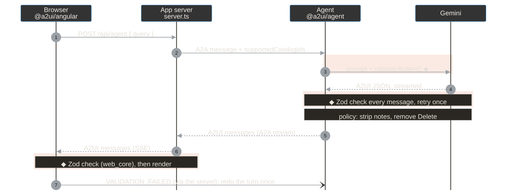
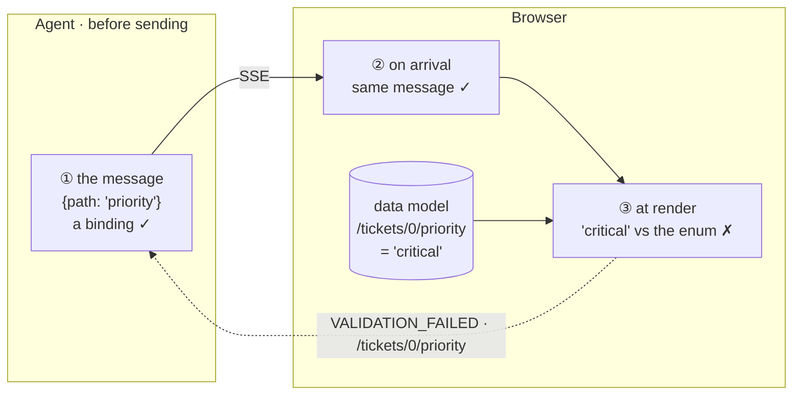

<div class="ta">
  <div class="ta-hero">
    <FitText>Your AI should not</FitText>
    <FitText serif>generate HTML.</FitText>
  </div>
  <div class="ta-foot" style="grid-template-columns:repeat(3,minmax(0,1fr)) auto;align-items:center">
    <div><b>Angular + A2UI</b><span>structured generative UI</span></div>
    <div><b>AngularDay 2026</b><span>Verona · 20 November</span></div>
    <div><b>Giorgio Galassi</b><span>ggalassi.dev</span></div>
    <div class="ta-qrs"><div class="qr-row">
      
      <span><b>Questions? Ratings?</b>use the AngularDay app</span>
    </div></div>
  </div>
</div>

<!--
Speaker notes:
Welcome the room. No preamble needed.
Then 15 seconds about you, no more: name, what you do (freelance senior Angular engineer, GDG Roma
Città), and that you built the demo you're about to show. The full "who I am" is at
the end.
Point at the QR once: questions can go in the AngularDay app during the talk,
and the same app is where they rate it. Q&A is at the end.
Let the title sit for a second before moving on.
This is an Advanced-level talk, 40 minutes with a live demo: a live agent drives the dashboard
(stub agent and recording ready as fallbacks).
Do not open with a broken React component or a horror-story HTML injection screenshot.
That framing is wrong and the audience will know it immediately — no serious team ships
raw LLM-generated HTML to production. Starting there feels like finding a problem for
a solution. Go straight into the real problem instead.
-->

---
rule: ['Part 1', 'The Problem']
---

<div class="ta">
  <div class="ta-hero">
    <FitText>The Problem.</FitText>
  </div>
</div>

<!--
~5 minutes.
-->

---
rule: ['The Problem', 'Part 1']
---

# Agents are already in production

They handle complex tasks. They call tools. They manage multi-step workflows.

And the moment they need to respond with something richer than text, they hit a wall.

<div v-click>

> "Generative AI excels at creating text and code, but agents can struggle to present
> rich, interactive interfaces to users, especially when those agents are remote or
> running across trust boundaries."

<div class="text-sm text-gray-400">

Source: [github.com/a2ui-project/a2ui — Summary](https://github.com/a2ui-project/a2ui#summary)

</div>

</div>

<!--
Speaker notes:

This is the actual opening line. Say it plainly, no dramatization.
The problem is not bad code quality. Not developer tooling.
It's agents that need to hand something visual and interactive back to a user,
in a system they do not fully control.
Pause after "they hit a wall" — let that land before moving to the quote.

[click: Google says it plainly]
Ground the problem in Google's own framing from the A2UI README before offering
your own take. This isn't me inventing a problem — Google's own team building this
standard describes it the same way.
Read the quote slowly. "Trust boundary" is the phrase to let land — that's the
crux of the whole talk. Not "agents write bad UI." Agents that are remote,
that you don't fully control, that need to hand back something interactive.
-->

---
rule: ['The Problem', 'Part 1']
---

# What the agent's options look like today

<div class="ta-cols c3">
<div v-click>

## Option <span class="blob-num">1</span> — Generate HTML or JSX and inject it

Unbounded output, no contract, no validation surface. By the time it renders,
it's too late to check. Across a trust boundary, you're executing arbitrary code
from a remote agent in your client application.

</div>
<div v-click>

## Option <span class="blob-num alt">2</span> — return data, let the frontend render it

Clean. Predictable. The frontend decides the screen; the agent only fills it.

It cannot say "show this as an approval workflow."
It cannot say "this data needs a date picker."

The agent is reduced to a JSON API with no say in presentation.

</div>
<div v-click>

## Option <span class="blob-num">3</span> — nothing

The agent responds in plain text.

The interactive experience is lost entirely.

</div>
</div>

<!--
Speaker notes:

Walk through the three options one at a time, don't rush.
Option 1 is the one everyone's instinct jumps to because it's what a browser-based
coding agent already does locally, in a sandbox you control. The moment the agent
is remote — a different service, a different trust domain — this stops being safe.
There's no way to inspect what you're about to execute before you execute it.

[click: Option 2]
This is the safe-but-limited option. Most teams that get nervous about option 1
land here by default. It's not wrong, it's just incomplete — you've solved safety
by removing the agent's ability to express intent about presentation at all.
The dashboard demo later in the talk is specifically the case where this breaks:
the agent needs to choose the shape of the response, not just supply values.
If someone asks "isn't A2UI also just JSON?": yes, both are JSON. The difference is
who decides the screen. Here the frontend has one fixed screen per kind of data and
the agent fills in values. With A2UI the agent picks which components and in what
layout (an approval flow, a date picker), but only from components the frontend
wrote and registered; how each one looks and behaves stays the frontend's.

[click: Option 3]
Quick beat, don't over-explain. This is the fallback most teams actually ship
when they hit the wall — chat-only, no rich UI at all, because option 1 is unsafe
and option 2 doesn't cover the intent the agent needs to express.
-->

---
rule: ['The Problem', 'Part 1']
---

# What if there was a <span class="hl">fourth option</span>?

What if the agent could describe *what* it wants to show, and the frontend could
decide *how* to show it — safely, within bounds it controls?

<div class="callout">

That question is what A2UI answers.

</div>

<!--
Speaker notes:
Deliver this as a genuine question, then pause before the callout line.
This is the hinge of the whole talk — everything after this slide is the answer.
-->

---
rule: ['Part 2', 'The Paradigm Shift']
---

<div class="ta">
  <div class="ta-hero">
    <FitText>The Paradigm Shift.</FitText>
  </div>
</div>

<!--
~5 minutes.
-->

---
rule: ['The Paradigm Shift', 'Part 2']
---

# The LLM becomes a <span class="hl">planner and composer</span>, not a code generator

<div v-click>

## This is not hypothetical

Google has published A2UI as an open-source standard — spec **v1.0** since
6 Nov 2026, **17k+ GitHub stars** — specifically designed to let agents "speak UI" through
a declarative JSON format rather than generating executable code.

</div>

<!--
Speaker notes:

State this clearly and let it sit as its own slide before backing it with evidence.
This single sentence is the reframe the rest of the talk builds on.

[click: This is not hypothetical]
Ground the shift immediately in reality, don't let it float as a concept.
This is a real, actively maintained standard with real adoption signal, not
a one-off research idea. That's worth saying explicitly for a room of engineers
who are going to ask "is this vaporware."
Check the star count on the day: the number moves.
-->

---
rule: ['The Paradigm Shift', 'Part 2']
---

# The core diagram

```
User Intent → LLM → A2UI JSON → Renderer → Native UI
```

<div v-click class="ta-beat">"Why is AI-generated JSON safer than AI-generated HTML?"</div>

<div v-click>

## The real argument

A2UI is a **declarative data format**, not executable code.

The client maintains a catalog of trusted, pre-approved components.
The agent can only request components from that catalog.

<div class="callout">

HTML has infinite surface area. A2UI has an <span class="hl">enumerable, allowlisted</span> one.

</div>

</div>

<!--
Speaker notes:

Walk left to right slowly. User intent goes into the LLM. The LLM's only output
is A2UI JSON — never markup, never executable code. The renderer — the Angular
app — turns that JSON into native UI using components it already trusts.
Hold here, because the next slide is the objection this diagram immediately raises.

[click: the question]
Say this as the question the audience is already forming. Don't answer immediately —
let it hang for a beat, then move to the next slide for the actual answer.
This is the objection-handling moment of the talk. If you skip it, the room
mentally checks out for the rest of the technical sections.

[click: The real argument]
This is the answer, and it's the sentence to get exactly right: "HTML has infinite
surface area. A2UI has an enumerable, allowlisted one." Say it slowly.
JSON isn't safe because it's JSON — plenty of JSON-based attacks exist.
It's safe here specifically because the vocabulary the agent can use is closed
and known in advance. That's the actual mechanism, not a vibe about data vs. code.
-->

---
rule: ['The Paradigm Shift', 'Part 2']
---

# Acknowledge maturity, up front

The A2UI spec reached **v1.0** on 6 Nov, declared stable.
The SDKs are still **0.x** and lag behind it. This demo runs **v0.9**, on purpose.

What you're learning today is the pattern and the architecture —
not a production dependency.

<div class="text-sm text-gray-400">

The specific library will stabilize. The renderer contract pattern will not change.

</div>

<!--
Speaker notes:
Say this honestly and don't rush past it. An advanced audience will respect you
more for naming the maturity level than for overselling it.
The facts (checked 2026-11-12): v1.0 became the current spec version on 6 Nov
(a2ui-project/a2ui PR #3999); the spec says breaking changes now go into a future
major version. No v1.0.0 package exists: @a2ui/angular is 0.14.0 on npm and
follows an earlier v1.0 draft (the @-prefixed component keys landed on main on
11 Nov, unreleased). The demo pins @a2ui/angular 0.13.0 and speaks v0.9: a
deliberate pin a week before the talk, not an oversight. Moving it is a
version bump plus @path / @call in the payloads, the pattern doesn't move.
The point to land: even if the `@a2ui/*` packages look different in a year,
the shape of the problem — catalog, capability negotiation, validation at the
boundary — is stable regardless of which library implements it. That's what
they should walk away holding onto.
-->

---
rule: ['Part 3', 'Where This Actually Makes Sense']
---

<div class="ta">
  <div class="ta-hero">
    <FitText>Where This Actually</FitText>
    <FitText>Makes Sense.</FitText>
  </div>
</div>

<!--
~5 minutes. One slide for the pattern (the industry examples are in its notes), one
for the sub-agent case, plus the "when NOT to use this" closing slide — do not skip it. The audience will ask "when would I actually
build this?" before buying into the architecture in Parts 4 to 6.
-->

---
rule: ['Where This Actually Makes Sense', 'Part 3']
---

# Why the standard approach breaks down

Hardcoded components with conditional rendering work well when the number of
possible UI states is enumerable and stable. They break down when:

- **The combinations explode** — 50 data dimensions × 10 roles is not 500 templates,
  it's a composition system you're building anyway
- **The interface responds to data you don't control** — enterprise customers bring
  their own schemas, clinical data varies per patient
- **Maintenance cost compounds** — every new template is a liability

<!--
Speaker notes:
Teams that build large configuration-driven UI systems eventually reinvent
something close to what A2UI formalizes — without the protocol, without the
validation layer, and without the capability negotiation. That's the honest
pitch: you're already halfway to building this. A2UI just names the pattern
and gives it a validation boundary.
-->

---
rule: ['Where This Actually Makes Sense', 'Part 3']
---

# One pattern behind every use case

Enterprise platforms, finance, healthcare: the flavour changes, the shape doesn't.

- **The screen can't be enumerated**: it depends on the customer's data model, the user's
  role and the question they ask
- **Today it's a configuration layer**: JSON config, feature flags, a library of pre-built
  views, or a custom dashboard per request
- **Every rendered element must be allowed and traceable**: per-role access, compliance
  reviews, audit

<div v-click class="callout">

A2UI replaces the configuration layer with an agent that composes from a
<span class="hl">validated catalog</span>, behind the access rules you already enforce.

</div>

<!--
Speaker notes:
One slide, three industries: say the pattern, then pick ONE example for the room (the
one closest to the audience) and keep the others for questions.

Enterprise internal tooling (Salesforce, ServiceNow, SAP): thousands of customers, each
with its own data model, roles and workflows. Today they run configuration systems,
low-code builders made of JSON config, feature flags and conditional rendering. The
agent reads the customer's data model and composes the surface on demand. The policy
layer maps onto the per-customer access restrictions they already enforce: you're not
adding a security model, you're moving it in front of generation instead of behind it.

Financial services dashboards: "show me exposure across these five positions with this
risk metric, broken down by region." Every answer is a different surface; today it's a
huge library of pre-built views or a custom dashboard per request. A validated catalog
of financial components is strictly safer than generated HTML, and the catalog plus the
role-based policy do the compliance job (what each role may see).

Healthcare and clinical decision support: a cardiologist's workflow looks nothing like an
oncologist's, and both change with the patient's data. The catalog is what makes a
compliance review possible at all: you can point to the exact, enumerable set of things
that could ever have been rendered, for any payload. Arbitrary HTML would never pass.

[click] The callout is the whole pitch of Part 3 in one line.
-->

---
rule: ['Where This Actually Makes Sense', 'Part 3']
---

# Remote sub-agents in an orchestrator

A parent agent delegates a task to a specialised sub-agent: a booking agent, a
reporting agent.

The sub-agent returns an A2UI payload. The parent renders it inline
**without knowing its structure in advance**.

<div class="callout">

The catalog defines the <span class="hl">contract</span> both agents work within.

</div>

<!--
Speaker notes:
This is the multi-agent case, and it gets its own slide because it's the one that
generalizes furthest. The parent doesn't need to know anything about the sub-agent's
internals: the shared catalog is the entire interface between them.
-->

---
rule: ['Where This Actually Makes Sense', 'Part 3']
---

# When NOT to use this

For a product with a fixed, well-understood user journey — a checkout flow,
a settings page, a login screen — **this is unnecessary complexity**.

<div class="callout">

If you can enumerate the states, <span class="hl">enumerate them</span>.

</div>

The paradigm earns its overhead when the interface is a function of data and
context that varies at runtime in ways you can't fully anticipate at build time.

<!--
Speaker notes:
This slide is not optional — it's the credibility slide. An advanced audience
trusts a speaker more, not less, for drawing the boundary of where their own
architecture doesn't apply. Say it plainly and don't hedge it.
-->

---
rule: ['Part 4', 'Anatomy of an A2UI System']
---

<div class="ta">
  <div class="ta-hero">
    <FitText>Anatomy of an</FitText>
    <FitText>A2UI System.</FitText>
  </div>
</div>

<!--
~10 minutes. This is the technical core.
-->

---
rule: ['Anatomy of an A2UI System', 'Part 4']
---

# The pieces

Three libraries from the A2UI project, one per side of the wire.

<div class="ta-cols c3">
<div v-click>

## `@a2ui/web_core`

The protocol itself, framework-agnostic: message schemas, catalogs written in Zod,
validation, the data model and bindings.

Both sides use it: the agent and the browser check against the same catalog.

</div>
<div v-click>

## `@a2ui/agent`

The agent's toolkit (Node): turns a catalog into the model's prompt, parses what the
model streams, validates every message before it leaves.

You still bring the model and the agent logic.

</div>
<div v-click>

## `@a2ui/angular`

The renderer: `provideA2Ui`, one `<a2ui-v09-surface>` per surface, and your
catalog of Angular components.

Built on `web_core`, with signals.

</div>
</div>

<div v-click class="text-sm text-gray-400">

Not from A2UI: the transport (A2A, `@a2a-js/sdk`) and the model (Gemini, `@google/genai`).
In the demo: `web_core` 0.14, `agent` 0.0.2, `angular` 0.13, all on protocol v0.9.

</div>

<!--
Speaker notes:
Before the pipeline, name the pieces, so nothing on the next slide is new.

Three packages, one job each.

[click: web_core] The protocol: the message shapes, the catalog as Zod, the
validation. It's the one both sides share, which is why the same catalog can be
checked on the agent and again in the browser.

[click: @a2ui/agent] The server side: it writes the catalog into the model's prompt
and checks what the model sends back, message by message, while it streams.

[click: @a2ui/angular] The renderer: a provider, an element per surface, and the
components you register.

[click: footer] What A2UI doesn't give you: how messages travel (we use A2A) and which model
writes them (Gemini). Those are your choices.
-->

---
rule: ['Anatomy of an A2UI System', 'Part 4']
---

# The full pipeline

<div class="dg dg-seq">



</div>

<div class="text-sm text-gray-400">

Time runs down. Requests go right, answers come back left. ◆ The Zod catalog checks here: the trust boundary.

</div>

<!--
Speaker notes:
Read it top to bottom: time goes down. Every arrow to the right is a request, every
arrow to the left is an answer coming back.

1, browser to our own server: plain POST /api/agent, SSE (Server-Sent Events) back.
That's our API (Application Programming Interface), not A2A (Agent2Agent protocol,
used here app-to-agent: our server to the agent). The browser never sees an A2A type;
it only gets A2UI (Agent-to-User Interface) messages.

2, server to agent: the only A2A (app-to-agent) hop. server.ts is the only file that
knows A2A exists, so swapping the transport for AG-UI (Agent-User Interaction
Protocol), MCP (Model Context Protocol) or plain REST (Representational State
Transfer) means rewriting one file. One agent, no agent-to-agent delegation here;
that's what A2A (agent-to-agent) would add later.

3 and 4, inside the agent: pick the catalog from supportedCatalogIds, put
catalog.toJson() in the prompt, and check every streamed message against the Zod
catalog, retrying once. Then the policy, on every message: the one check validation
can't replace.

5 and 6, back to the browser: web_core checks the same Zod catalog again on arrival,
then Angular renders your components.

7, the last arrow: the renderer reports VALIDATION_FAILED (app code, not web_core),
through our server; the agent redoes the turn once, then answers in text.

The ◆ marks are where Zod checks the agent's output. That's the next section.
-->

---
rule: ['Part 5', 'The Trust Boundary']
---

<div class="ta">
  <div class="ta-hero">
    <FitText>The <span class="hl">Trust Boundary.</span></FitText>
  </div>
</div>

<!--
Speaker notes:
The ◆ in the pipeline: one Zod catalog, checked three times. In the prompt (the
model only sees what the catalog allows), on the agent (before anything leaves),
and in the browser (before anything renders). The next three slides: that catalog, the
policy that comes after it, and what the two can't do on their own.
~6 minutes.
-->

---
rule: ['The Trust Boundary', 'Part 5']
---

# One catalog, checked three times

<div class="ta-cols" style="grid-template-columns: 1.15fr 1fr">
<div>

```ts
// packages/catalog: one ComponentApi per component
export const PriorityBadgeApi = {
  name: 'PriorityBadge',
  schema: z
    .object({
      priority: z
        .union([z.enum(PRIORITIES), DataBindingSchema])
        .describe("The ticket's priority, or a binding to it."),
    })
    .strict()
    .describe("A coloured badge showing a ticket's priority."),
} satisfies ComponentApi;
```

</div>
<div>

◆ **In the prompt.** `@a2ui/agent` writes it as JSON Schema (`catalog.toJson()`):
the model only sees what the catalog allows.

◆ **On the agent.** Every streamed message is checked against the same Zod
before it leaves; a failure goes back to the model once.

◆ **In the browser.** `web_core` checks it again on arrival; the Angular
component is typed from the same object.

</div>
</div>

<div v-click class="callout">

Zod isn't the validation you bolt on. It's the <span class="hl">language</span> the whole agent–client
contract is written in.

</div>

<div class="text-sm text-gray-400">

The wire carries only the catalog id (`supportedCatalogIds`). Source:
[components.ts](https://github.com/giorgiogalassi/talk-a2ui/blob/main/demo/packages/catalog/src/components.ts) ·
[catalog/types.ts#L179-L196](https://github.com/a2ui-project/a2ui/blob/45633b9/typescript/core/web_core/src/catalog/types.ts#L179-L196)

</div>

<!--
Speaker notes:
This is the point that connects back to the "Kneel Before Zod" material for anyone
who's seen that talk: Zod shows up here in a completely different role than
validating form input.

Point at the code: z.enum limits priority to four strings, DataBindingSchema lets
the agent bind it to the data instead of hardcoding a value, .strict() rejects any
prop the schema doesn't name. The .describe() strings end up in the prompt: they're
the only documentation the model gets.

Then the three ◆, the same marks as in the pipeline. In the prompt, the model is
constrained upfront: it never sees components or values outside the schema as
options. On the agent, if the model drifts anyway, the check catches it before the
user does. In the browser, the same object again: packages/catalog is imported by
both the agent and the Angular app. Add a fifth priority to the enum and the prompt,
both checks and the component's types all change together.

[click: callout] For an audience that knows Zod from runtime validation, this is
the reframe, and the sentence people should be quoting after the talk. Let it
breathe.
-->

---
rule: ['The Trust Boundary', 'Part 5']
hide: true
---

# A binding is checked <span class="hl">at render</span>

Same `PriorityBadgeApi` everywhere: `priority` is the enum **or** a binding `{path}`.



<div class="callout">

The agent checks the <span class="hl">message it writes</span>; the browser checks the <span class="hl">values it renders</span>.

</div>

<!--
HIDDEN backup slide (hide: true). For Q&A: when someone asks about bindings (the dev.to
comment of 18 Nov), press G and type "binding" to jump here. To show it in the talk,
remove `hide: true`. It follows "One catalog, checked three times": same catalog, but
for a bound prop the value only exists at render, so the browser checks it there.

One schema, from @demo/catalog: priority is the enum OR a binding.
1 + 2 check the component message: {"path":"priority"} matches the binding
branch, so both pass, whatever the data holds. The binding schema only checks the
shape {path: string}.
3 is the only place a value exists: the renderer resolves the path against the
data model (row context /tickets/0), and resolved-value.ts checks it against the
same schema minus the binding branch. 'critical' fails: "?" on the badge,
VALIDATION_FAILED back to the agent, one retry.
Honest caveat: check 3 is the demo's code, not web_core 0.14, and covers
top-level props only. That's the upstream issue (drafted, links a2ui #989).
Spec caveat, if asked: in v0.9, VALIDATION_FAILED's "path" points into the
MESSAGE (e.g. /components/0/text), not the data model. The demo sends the
data-model path (/tickets/0/priority): it stretches the spec. Say "a data-model
path, which the spec doesn't quite cover yet"; the closer existing code is
EXPRESSION_ERROR (what web_core uses for function arguments that fail after
resolving).
-->

---
rule: ['The Trust Boundary', 'Part 5']
---

# Valid isn't <span class="hl">allowed</span>

The catalog answers one question: *is this a valid UI?* It can't answer the next one:
*may this user see it?*

<div class="ta-cols" style="grid-template-columns: 1.6fr 1fr">
<div>

```ts
// apps/agent/src/policy/policy.ts
export const DEMO_POLICY: Policy = {
  forbiddenDataPaths: ['/tickets/*/internal_notes', '/ticket/internal_notes'],
  disabledActions: ['delete_ticket'],
  // the notes themselves, if the model writes them out
  forbiddenText: readInternalNotes(),
};
```

</div>
<div>

A `Text` bound to internal notes is **valid**. So is *Delete* for someone who may
not delete.

Yours, **server-side**, after validation, on **every streamed message**.

</div>
</div>

<div v-click class="callout">

A denylist only blocks what you anticipated. In production: an allowlist per view.

</div>

<div class="text-sm text-gray-400">

Source: [policy.ts](https://github.com/giorgiogalassi/talk-a2ui/blob/main/demo/apps/agent/src/policy/policy.ts) ·
[samples/client/angular/README.md#L58-L64](https://github.com/a2ui-project/a2ui/blob/45633b9/samples/client/angular/README.md#L58-L64)

</div>

<!--
Speaker notes:
This is the distinction people ask about in Q&A if you don't make it now. A2UI's
own validation checks structure and types against the catalog. It has no idea about
your business rules: which role can see which field, which action is disabled for
whom. That layer is yours, and it sits server-side, before the payload reaches the
browser, or a client-side bypass defeats the point.

What it does in the demo: deletes the forbidden paths from every data update,
removes components that bind them or carry a disabled action (and mends the tree so
it stays valid), and withholds any text that quotes the notes, because the model is
given them on purpose, as a real backend would.

Why every message: the agent streams, and each re-send reaches the browser right
away. In the tests the raw stream carried internal_notes in re-sends well before
the last one. Filtering only the final answer comes too late.

[click: callout] The honest limit, from building it: the first policy listed
/tickets/*/internal_notes and missed the detail view's /ticket/internal_notes. The
same data under another name walks through a denylist. That's why production wants
an allowlist per view. You'll see this policy at work in the demo, stage 3.
-->

---
rule: ['The Trust Boundary', 'Part 5']
---

# What the boundary guarantees, and what it doesn't

<div class="ta-cols c2">
<div>

## Guaranteed

The agent composes only from the catalog. It cannot invent a component, a prop or
a value the schema doesn't name; unknown types are rejected before rendering.

The renderer is **structurally deterministic**: the same payload and state give the
same tree, which components, in which order, with which inputs.

</div>
<div v-click>

## Not guaranteed

**Valid components in a harmful combination**: a "Confirm" button next to text that
misleads. Each piece passes; the whole is wrong.

**What the policy didn't anticipate**: a paraphrase of the notes, a field under a
new name.

</div>
</div>

<div v-click class="callout">

A2UI is not AI magic. It's a <span class="hl">controlled rendering contract</span>: it fixes what can
appear, not whether it makes sense.

</div>

<!--
Speaker notes:
Say the first column plainly. If anyone asks "what if the agent tries something
malicious": it structurally cannot reference anything outside the catalog, full stop.

On "deterministic", be precise, an advanced audience pushes back on an overclaim:
not pixel-identical output forever. The tree shape and the component boundary are
fixed by the payload, not by anything the model does at render time. Components can
still vary inside: internal state, async data, user context.

[click: Not guaranteed] The honesty slide. Valid components can still be combined
into something misleading; the schema checks pieces, not intent. Narrowing that is
work in the spec too: A2UI 1.0 catalogs can declare allowedParents and
allowedChildren, so a component in the wrong place is rejected. And the policy only
covers what you wrote down.

[click: callout] Close of the section. Let it sit, then into Angular: where the
catalog becomes components.
-->

---
rule: ['Part 6', 'Angular as the Rendering Engine']
---

<div class="ta">
  <div class="ta-hero">
    <FitText>Angular as the</FitText>
    <FitText>Rendering Engine.</FitText>
  </div>
</div>

<!--
~15 minutes.
-->

---
rule: ['Angular as the Rendering Engine', 'Part 6']
---

# A2UI is framework-agnostic

The same JSON payload can be rendered in Flutter, Lit, React, or SwiftUI.

You're using Angular because it fits this architecture exceptionally well —
here's the specific technical case for why.

<!--
Speaker notes:
Own this directly and don't undersell it. Nobody in the room should think
you're claiming Angular is required. The claim is narrower and stronger:
Angular's existing primitives happen to map almost exactly onto what this
protocol needs, and that's worth walking through concretely rather than
asserting.
-->

---
rule: ['Angular as the Rendering Engine', 'Part 6']
---

# Your entire <span class="hl">rendering</span> integration

```ts {1-4|6-10|12-13}
// app.config.ts
provideA2Ui(() => ({
  catalogs: [createTicketCatalog(), new BasicCatalog()],
}))

// app.ts template: one element per surface, tracked by the surface object
// (a corrected reply re-creates a surface under the same id)
@for (entry of renderer.surfaceGroup.surfacesMap; track entry[1]) {
  <a2ui-v09-surface [surfaceId]="entry[0]" />
}

// agent-client.ts: every A2UI message the agent streams
renderer.processMessages([message]);
```

<div class="text-sm text-gray-400">

Around it: the client that brings the messages in and sends actions back (adapted from Google's
Angular sample, ~100 lines), and the error reporting of stages 5–6 (ours: web_core doesn't send
`VALIDATION_FAILED` yet).

Source: [app.config.ts](https://github.com/giorgiogalassi/talk-a2ui/blob/main/demo/apps/client/src/app/app.config.ts) ·
[app.ts](https://github.com/giorgiogalassi/talk-a2ui/blob/main/demo/apps/client/src/app/app.ts) ·
[agent-client.ts](https://github.com/giorgiogalassi/talk-a2ui/blob/main/demo/apps/client/src/app/agent/agent-client.ts) (trimmed)

</div>

<!--
Speaker notes:
Let this sit on screen for a second — it's deliberately anticlimactic.
Rendering A2UI in Angular is one provider, one element per surface, and one
call per message. That's all the library asks of the app.

Be precise about the word "rendering": the app also needs a client that talks
to its agent (A2UI doesn't fix a transport, so the library ships none; ours is
adapted from Google's Angular sample, about a hundred lines), and the demo adds
its own error reporting for stages 5–6, because web_core doesn't send
VALIDATION_FAILED yet. The real config also passes an `actionHandler` that sends
button actions back to the agent; trimmed here.

On `track entry[1]`: track the surface object, not its id. A corrected reply
re-creates a surface under the same id; tracked by id, Angular keeps the old
drawing (incident 6 in the demo README).

Everything else lives in the catalog you write next.
-->

---
rule: ['Angular as the Rendering Engine', 'Part 6']
---

# What your catalog looks like

```ts {3|4-6}
// Pair each Zod ComponentApi with the Angular component that draws it
new AngularCatalog(TICKET_CATALOG_ID, 'v0.9', [
  ...BASIC_COMPONENTS.filter((impl) => basicNames.has(impl.name)),
  createComponentImplementation(TicketListApi, TicketListComponent),
  createComponentImplementation(PriorityBadgeApi, PriorityBadgeComponent),
  createComponentImplementation(AssigneeChipApi, AssigneeChipComponent),
], [], BasicCatalogThemeSchema);
```

<div class="text-sm text-gray-400">

Source: [ticket-catalog.ts](https://github.com/giorgiogalassi/talk-a2ui/blob/main/demo/apps/client/src/app/catalog/ticket-catalog.ts)

</div>

<!--
Speaker notes:
This is the artifact your team actually maintains: a list of API/implementation
pairs. Each `Api` is the Zod schema from Part 5, imported from the same
`packages/catalog` the agent validates with. Each implementation is a normal
Angular component. The basic components (Text, Row, Card…) are the library's
own, filtered to the ones the catalog lists. No special DSL beyond this.
-->

---
rule: ['Angular as the Rendering Engine', 'Part 6']
---

# What the renderer does for you

`@a2ui/angular/v0_9` ships a `SurfaceComponent` (`<a2ui-v09-surface>`) you drop into your app.

It handles, internally:
- receiving A2UI messages: `A2uiRendererService.processMessages()` feeds the `MessageProcessor` from `web_core`
- resolving component types from your catalog
- dynamically instantiating Angular components via `ComponentHostComponent`
- wiring up reactive property bindings via `ComponentBinder`

<div class="text-sm text-gray-400">

Source: [surface.component.ts#L43-L52](https://github.com/a2ui-project/a2ui/blob/45633b9/typescript/renderers/angular/src/core/surface.component.ts#L43-L52) ·
[component-host.component.ts#L252](https://github.com/a2ui-project/a2ui/blob/45633b9/typescript/renderers/angular/src/core/component-host.component.ts#L252)

</div>

<!--
Speaker notes:
Start the section here — this reframes everything correctly before diving into
mechanism. What you write is a catalog. What the library gives you is a renderer.
Your custom components extend `CatalogComponent<typeof XApi>`, which types
`props()` straight from the Zod `ComponentApi`; each prop is a bound property
whose `value()` is an Angular signal (web_core runs on Angular's own signals,
next slide). (`BasicCatalogComponent` is the subclass the library's own basic
components use; the demo's custom ones don't need it.)
The example to pull up live if time allows: the demo's PriorityBadge,
demo/apps/client/src/app/catalog/priority-badge.ts.
-->

---
rule: ['Angular as the Rendering Engine', 'Part 6']
---

# Reactivity: one signal graph, Angular's

`web_core` writes its reactivity against a small signal API: `signal`, `computed`, `effect`.
By default it runs on `@preact/signals-core`: tiny, framework-free.

The Angular renderer **swaps in Angular's own signals** at startup. No bridge between two
systems: every signal `web_core` creates is an Angular signal.

```ts {1-2|4-7}
// @a2ui/angular, once per app (initializeAngularReactivity)
setSignalImplementation({ signal, computed, effect, /* … from @angular/core */ });

// your catalog component: props().priority is an Angular signal
export class PriorityBadgeComponent extends CatalogComponent<typeof PriorityBadgeApi> {
  protected readonly priority = computed(() => this.props().priority?.value());
}
```

<div class="text-sm text-gray-400">

Source: [signals.ts#L62-L97](https://github.com/a2ui-project/a2ui/blob/45633b9/typescript/core/web_core/src/reactivity/signals.ts#L62-L97) ·
[reactivity.ts#L48-L103](https://github.com/a2ui-project/a2ui/blob/45633b9/typescript/renderers/angular/src/core/reactivity.ts#L48-L103) ·
[component-binder.service.ts#L45-L58](https://github.com/a2ui-project/a2ui/blob/45633b9/typescript/renderers/angular/src/core/component-binder.service.ts#L45-L58) ·
[priority-badge.ts](https://github.com/giorgiogalassi/talk-a2ui/blob/main/demo/apps/client/src/app/catalog/priority-badge.ts)

</div>

<!--
Speaker notes:
The common assumption is that A2UI "uses Preact signals" and Angular bridges them.
It doesn't. web_core is written against an abstract signal API, and the default
implementation is @preact/signals-core because it's tiny and framework-free: that's
what runs in the Node agent or on a plain web-components page.

A framework can provide its own. The Angular renderer does, once per app:
initializeAngularReactivity calls setSignalImplementation with signal, computed and
effect from @angular/core (plus batchWrite, getValue, setValue…). It runs the first time
A2uiRendererService or ComponentBinder is created, whichever comes first; in the demo
that's the renderer service, injected at startup. A flag makes later calls no-ops; it must
run before web_core creates its first signal. From then on, the data model's per-path signals, resolved
bindings and computed values are all Angular signals. One graph, Angular's.

[click: the component] What you write: ComponentBinder resolves each prop to
{ value, raw, onUpdate }, the component host passes that in as the `props` input of your
CatalogComponent, and value() is a plain Angular signal read. computed() tracks it
natively. The type comes from PriorityBadgeApi, so there's no props interface to keep in
sync.

If asked: the swap is global to the page (module-level state in web_core), so two
different renderers on one page would compete for it. An edge case, but a real one.
How the React renderer does it, I haven't checked.
-->

---
rule: ['Angular as the Rendering Engine', 'Part 6']
---

# Why the message split matters

A2UI separates component **structure** from **data** into distinct message types:

- `updateComponents` — defines the tree
- `updateDataModel` — updates a single JSON Pointer path

<div class="callout">

Only the signal at that path changes (in Angular, an Angular signal). Only the
`computed()` that reads it re-evaluates. Only the component that depends on it
re-renders. The rest of the surface is untouched.

</div>

<div class="text-sm text-gray-400">

Source: [a2ui_protocol.md#L21-L28](https://github.com/a2ui-project/a2ui/blob/45633b9/specification/v0_9/docs/a2ui_protocol.md#L21-L28) ·
[data-model.ts#L84-L90](https://github.com/a2ui-project/a2ui/blob/45633b9/typescript/core/web_core/src/state/data-model.ts#L84-L90) (one signal per path)

</div>

<!--
Speaker notes:
This is the architectural payoff of the signal-per-path design, and it's worth
slowing down for. When the agent streams a data update, it's targeting one
JSON Pointer path — not re-sending the whole tree. That precision is what
makes fine-grained reactivity possible at all downstream.
And because web_core runs on Angular's signals here (previous slide), "the signal at
that path" is an Angular signal: nothing to translate between the protocol and the
component.
-->

---
rule: ['Angular as the Rendering Engine', 'Part 6']
---

# Zoneless and streaming

A2UI streams many small `updateDataModel` messages, each targeting one
JSON Pointer path. In a zoneless app, each one:

- **writes one signal** in the data model
- re-runs only the **computed signals** that read it
- updates only the **components** whose templates read those: nothing else is checked

<div v-click class="callout">

For a data-heavy dashboard receiving live updates: the difference between a
performant and a <span class="hl">sluggish</span> surface.

</div>

<div class="text-sm text-gray-400">

We used to have zone.js, where every async message re-ran change detection across
the whole app. Zoneless is the default since Angular 21 (stable since 20.2) and OnPush
since 22: the demo needs no setup for either.

</div>

<!--
Speaker notes:

Don't just name-drop Zoneless here — make the specific case, this is the slide
where a skeptical Angular engineer decides whether you actually understand the
mechanism or are pattern-matching buzzwords.

Walk the three bullets as one chain: message → one signal → its computeds → the
templates that read them. That's the same chain the signal graph shows in the demo
(stage 7: data model signal at the top, computeds, template at the bottom).

zone.js gets one sentence, in the past tense (the footnote): it's how Angular used to
know "something async happened, check everything". Don't compare at length: the room
knows it, and on 21+ it's simply gone by default.

[click: callout] The payoff, for the dashboards of Part 3.
-->

---
rule: ['Angular as the Rendering Engine', 'Part 6']
---

# Standalone components and the registry pattern

Each registered component is:

- fully self-contained, with its own imports
- free of NgModule coupling that could cause side effects when loaded dynamically
- individually tree-shakeable

The dynamic loading in `ComponentHostComponent` relies on exactly this.

<!--
Speaker notes:
Quick, confident close to the section. Standalone components aren't incidental
here — the dynamic-instantiation model in `ComponentHostComponent` needs
components that can be loaded in isolation, without a module graph to resolve
first. That's precisely what standalone gives you.

Then: "Let's see it." Switch to the demo section.
-->

---
rule: ['Part 7', 'Demo']
---

<div class="ta">
  <div class="ta-hero">
    <FitText>Live Demo.</FitText>
  </div>
</div>

<!--
~10 minutes. Next slide: tell the room what to watch for, then switch the second
screen to the app, full screen. Your run-sheet is in the next slide's notes.
-->

---
rule: ['Demo', 'Part 7']
---

# What to watch for

A support desk. One prompt: *"Show me the open tickets"*. Then seven moments.

1. **Negotiation**: the agent learns which catalog the app speaks, before any UI exists ◆
2. **The answer is JSON**: readable, and made only of the catalog's components
3. **The policy**: internal notes and the *Delete* button never reach the browser
4. **The agent rejects its own answer**: a value outside the catalog, caught and retried ◆
5. **The browser rejects a value**: `VALIDATION_FAILED` goes back, the turn is redone ◆
6. **Never a broken screen**: a placeholder for the bad part, or a plain text answer
7. **Streaming**: the list fills in, and only what reads the changed data updates

<!--
Speaker notes:
Read the list once, quickly, then switch the second screen to the app, full screen.
This slide is the room's map; they won't see it again until you come back.

RUN-SHEET (you see this in /presenter while the app is on the other screen)
Before: npm run demo:live (or npm run demo for the stub), open http://localhost:4200
(localhost, not 127.0.0.1). Panel: Alt+Shift+D. Agent terminal visible on your
screen.

1. Negotiation. Ask "Show me the open tickets". Show the agent terminal:
   "--- capabilities: {"v0.9":{"supportedCatalogIds":[...]}} -> v0.9 ---". The
   browser never sends this; our server adds it. Only catalog ids travel.
2. JSON. Panel: "Show JSON" on. The drawer next to the app shows the last turn's
   messages, one block per SSE event: createSurface, updateComponents,
   updateDataModel. Readable. (Not DevTools Network: the client reads the stream
   with fetch(), so Chrome shows no EventStream tab and no response body.)
3. Policy. Panel: Stub + "Leaky replies" on. Ask again, open a ticket. Agent log:
   "--- policy: stripped /tickets/0/internal_notes ---", "removed Button delete".
   The detail view has no Delete and no notes. Live, the model rarely gives the
   policy anything to strip: that's why the stub switch exists.
4. Agent rejects. Panel: "First attempt invalid" on (Leaky off). Agent log:
   "A2UI validation failed ... received 'critical' (Attempt 1)", then Attempt 2/2.
   The list arrives valid.
5. Browser rejects. Panel: "Renderer rejects first attempt" on. The list shows a
   "?" badge for a moment; agent log: "A2UI client reported VALIDATION_FAILED ...
   /tickets/0/priority", "Retrying the last turn", corrected list.
6. Never broken: the "?" placeholder was it; a second failure gets text
   (FALLBACK_TEXT), never a broken surface.
7. Streaming. Show JSON drawer: the updateDataModel blocks arrive one per event.
   Then Angular DevTools -> Components -> app-ticket-list -> Show Signal Graph:
   the data model signal at the top, computeds down to children/title, the
   template at the bottom. "updateDataModel writes one signal; only what reads
   it updates." Profiler only as a one-liner: one cycle, only the app shell
   checked (it doesn't list the A2UI components as checked: their updates come
   through signals). Checked in Stub 2026-11-18; Live still to check.

If the model is slow or down: switch to Stub in the panel and say so openly. The
recording is the last resort (~/Desktop/angularday-a2ui-demo.mp4).

REHEARSAL NOTES (walk-through of 18 Nov, all 7 stages in Stub)
Before: run `npm run demo:live` in YOUR terminal (the agent log is half the demo).
DevTools closed or undocked (docked, it squeezes the app). Panel: Alt+Shift+D.
Live failed 3/3 on 18 Nov (Gemini 503 "high demand"): if it happens on stage, say
"the model is down and the app still answers" (that IS stage 6), switch to Stub.

1. capabilities line = the negotiation. Only the catalog id travels, the agent
   already holds the Zod catalog. The browser never sends it: server.ts adds it.
2. Three messages: createSurface (surface + catalog id), updateComponents (the
   tree; components point at data with "path"), updateDataModel (the data).
   Only catalog components, no HTML/script. Browser sees { messages, sessionId }.
   Why the drawer and not Network: fetch() + getReader(), Chrome shows nothing.
3. Leaky replies are schema-VALID. Schema: "is this a valid UI?"; policy: "may
   this user see or do this?". Filters mid-stream re-sends too. Live rarely leaks:
   that's why the stub switch exists, say so.
4. "critical" as a LITERAL in the component: the agent's Zod (enum branch) rejects
   it before sending, retries once with the error. Browser sees only the valid list.
5. "critical" in the DATA MODEL, the badge binds {"path":"priority"}: the agent
   passes it (a binding only has to be {path: string}). The browser resolves the
   binding (/tickets/0 + priority = /tickets/0/priority), checks the value against
   the enum (resolved-value.ts: same schema minus the binding branch), shows "?",
   sends VALIDATION_FAILED with path + message, the agent redoes the turn once.
   In Stub the "?" lasts a blink: announce it BEFORE clicking; proof = the agent
   log + the drawer header ("VALIDATION_FAILED report (/tickets/0/priority)").
6. The floor: a placeholder for one bad value; plain text (FALLBACK_TEXT) after a
   second failure or a model error. Never a half-rendered surface.
7. Signal graph: blue = writable, green = computed, grey = the template. Top
   "Unnamed Array(3)" = the data model's /tickets signal. "Unnamed" = created by
   web_core's data model through Angular's signal() (setSignalImplementation, slide
   27); the compiler only names signals declared as class fields or inputs.

IF ASKED
- Same schema on both sides? Yes, one source (@demo/catalog): three checks. Agent
  checks the message it writes; web_core re-checks it on arrival; the browser
  checks the VALUES it renders (hidden slide after "One catalog, checked
  three times": press G, type "binding").
- Why bind instead of a literal? Lists (one row template, N rows), updates
  without re-sending components (stage 7), data that flows back (forms, action
  context), values from your backend. Literals for constants ("Open").
- Why not check the value on arrival? Without the union the binding itself fails;
  the data may arrive later or change (streaming, user input); one binding = many
  values (one per row context).
- Is the value check A2UI's? No: web_core 0.14 checks only the binding's shape.
  The demo adds it, top-level props only (a nested prop isn't covered). Upstream
  issue drafted.
- VALIDATION_FAILED with a data-model path? The v0.9 spec means a path into the
  message; ours stretches it. Closer code: EXPRESSION_ERROR. Open question upstream.
-->

---
rule: ['Demo', 'Part 7']
---

# What you just saw

| | Moment | What it proved |
|---|---|---|
| 1 | Negotiation | Only a catalog id travels; the agent already holds the schema ◆ |
| 2–3 | JSON, then the policy | Data, not code; and *valid* is not *allowed* |
| 4–5 | Two rejections | The same Zod, on the agent and in the browser, with a way back ◆ |
| 6–7 | No broken screen, streaming | Failures degrade; signals re-render only what changed |

<div class="callout">

The agent never touched the DOM. The system <span class="hl">controlled the model</span>, not the other way
around.

</div>

<!--
Speaker notes:
Back from full screen. Re-anchor the room: point at each row, one sentence each.
Then the line in the callout. Deliver slowly: the payoff of the demo and arguably
the talk.

On model choice, if asked: Gemini through @google/genai, one tool (get_tickets),
thinking MINIMAL for latency. No response_schema: the catalog in the prompt and the
Zod check after it do that job. The architecture is model-agnostic.
-->

---
rule: ['Part 8', 'Production Reality']
---

<div class="ta">
  <div class="ta-hero">
    <FitText>Production Reality.</FitText>
  </div>
</div>

<!--
~5 minutes.
-->

---
rule: ['Production Reality', 'Part 8']
---

# Security

The catalog and the policy are the boundary (Part 5). Around them, the Angular
README names three threats to plan for:

- **UI spoofing**: a valid component made to look like something it isn't
- **Property injection (XSS)**: strings that reach the DOM
- **Denial of service** via layout complexity: deep or wide trees

<div class="text-sm text-gray-400">

Source: [samples/client/angular/README.md#L58-L64](https://github.com/a2ui-project/a2ui/blob/45633b9/samples/client/angular/README.md#L58-L64)

</div>

<!--
Speaker notes:
Don't repeat the catalog and the policy: point back to Part 5 in one sentence.
Angular's native property binding sanitization handles the XSS case directly —
no extra library needed, it's the same sanitizer Angular already runs for
every binding. The flat adjacency list format used for the component tree
makes complexity-based DoS attacks easier to detect and limit than a nested
tree would be, since depth and fan-out are cheap to bound-check.
-->

---
rule: ['Production Reality', 'Part 8']
---

<div class="ta-cols c3">
<div>

## Reliability

Two loops, both with one retry: the agent checks every message before it ships,
and the renderer reports what it rejects (`VALIDATION_FAILED`).

<div class="callout">

This is not a silent drop. It's a feedback loop.

</div>

Define fallback surfaces for each failure level before you need them. Budget for
latency: 4–7 s to the first UI live (Gemini, 12 Nov).

</div>
<div v-click>

## Observability

Every A2UI payload is a **structured, loggable artifact**.

You can trace exactly what the agent *intended* versus what the renderer
*produced*.

<div class="text-sm text-gray-400">

A significant advantage over AI-generated HTML, which gives you no equivalent
structured trace.

</div>

</div>
<div v-click>

## Performance

Separate `updateComponents` / `updateDataModel` message types.

Per-path signals: Angular's own, plugged into `web_core`. Computed signals with
OnPush. Zoneless.

<div class="callout">

These compose into a genuinely efficient streaming surface.

</div>

</div>
</div>

<!--
Speaker notes:

[Reliability]
Tie this back to demo stages 4 and 5: the room just saw both loops.
On the client, the protocol defines the same signal: a `VALIDATION_FAILED`
error message from renderer to agent. The demo sends it (app code, not web_core)
and the agent retries once on it. The point: failure is communicated back to the agent,
which means the agent can potentially retry or degrade gracefully, rather than
the user just seeing a broken page with no explanation anywhere in the system.

[click: Observability]
Quick slide — the point is simple and doesn't need much elaboration. With raw
HTML generation you can log the string, but you have no structured way to ask
"did the agent try to do something it wasn't allowed to do." With A2UI, the
payload itself is the audit trail.

[click: Performance]
This is the summary slide tying together the reactivity and zoneless slides — don't re-explain the
mechanism, just name the pieces and let the room recall what they already saw.

[After the Performance click]
End of the content. Next: the wrap-up, then Questions (the MC runs the Q&A).
-->


---
rule: ['Wrap-up', 'A2UI · AngularDay 2026']
---

# Three things to take home

<div class="ta-cols c3">
<div v-click>

## The catalog

The agent describes the screen; your frontend decides what can appear on it.

</div>
<div v-click>

## The boundary

One Zod catalog, checked three times. And *valid* still isn't *allowed*: the
policy is yours.

</div>
<div v-click>

## Angular

It renders the result with signals, zoneless. The transport is one file you can
swap.

</div>
</div>

<div v-click class="callout" style="font-size: 1.7rem; line-height: 1.3; margin-top: 1.6rem">

The agent composes the screen. You design <span class="hl">what it composes with</span>.

</div>

<!--
Speaker notes:
About a minute. One sentence per column, then the callout.

[click: The catalog] [click: The boundary] [click: Angular]
Don't re-explain, name them: the room has seen all three.

[click: callout] Say this around it, slowly:
"People will ask an agent instead of clicking through our apps. They'll still need
an interface they can trust, built from our components and shaped by what they just
asked. Designing that is the next job for frontend developers."

If time's up: skip the columns, say only that.
Then Questions: the MC runs the Q&A and its time.
-->

---
rule: ['Questions', 'A2UI · AngularDay 2026']
---

<div class="ta">
  <div class="ta-hero">
    <FitText>Questions?</FitText>
  </div>
  <div class="ta-promo">
    <!-- TODO masterclass: replace the placeholder with  once the link exists -->
    <div class="qr-placeholder" aria-hidden="true">QR<br>soon</div>
    <div>
      <b>Go deeper: the A2UI masterclass</b>
      <span>Structured generative UI with Angular, hands-on · December · sign up via the QR</span>
    </div>
  </div>
</div>

<!--
Speaker notes:
Open the Q&A with the masterclass in one sentence: "If you want to build this
hands-on, I'm running a masterclass in December: the QR stays up the whole Q&A."
Then take questions.
The wrap-up is already done (previous slide). The MC manages the Q&A and its time;
if someone needs longer, "find me after, I'm around all day."
When the MC closes it: the thank-you slide (rate the talk, links).

Q&A prep — likely questions:
- "Is A2UI production-ready?" → The spec is v1.0 and stable since 6 Nov; the
  libraries are still 0.x and the demo pins v0.9. The pattern is what to adopt now;
  the specific library will stabilize. See the Part 2 maturity slide.
- "What about React/Vue teams?" → A2UI is framework-agnostic (Part 6 opener).
  The Angular-specific argument is about fit, not exclusivity.
- "Doesn't the agent still need to know the catalog?" → Yes — that's the point.
  Capability negotiation sends the catalog to the agent before generation
  (Part 5). It's a closed, known vocabulary, not an open one.
- "What stops a compromised agent from requesting a valid-looking but malicious
  combination of valid components?" → Server-side policy enforcement ("Valid
  isn't allowed", Part 5) is the layer for this — catalog validation checks
  shape, not business rules. And say the honest limit ("What the boundary
  guarantees, and what it doesn't").

- "Where is this heading?" → was Part 7, The Future (moved off the slides 2026-11-14; no published source, it is my projection). Renderers checked on a2ui-project/a2ui main 2026-11-14: Angular, React, Lit (TypeScript), Flutter (Dart), SwiftUI (Swift, via SwiftPM). Jetpack Compose is only named in the README, no renderer in the repo.

# A component that describes itself

Imagine a `<calendar>` component that, alongside its rendering logic, exposes
a schema describing its own capabilities: what actions it accepts, what data
it needs, what events it emits.

Any agent, without knowing the component exists, can compose it correctly —
because the capability negotiation protocol already handles exactly this
exchange.

The component advertises itself. The agent operates within what it's been shown.

Notes: Ground the future section with this one concrete example before going broad —
don't jump straight to the abstract vision. This is a natural extension of
the capability manifest mechanism from Part 4, just pushed further: instead
of a fixed catalog manifest, individual components self-describe.

# The broader vision

A2UI is already pointing here.

The same agent composes a surface that renders natively in **Angular**,
**Flutter**, or **SwiftUI** — from the same JSON payload.

The frontend stops being a passive render target and becomes a capability
system.

Notes: Widen the lens here. Everything in the talk was scoped to one Angular app —
this is the reminder that the protocol itself doesn't care which renderer
is on the other end, and that's a deliberate design choice, not an accident.
-->

---
rule: ['Thank you', 'ggalassi.dev']
---
<div class="ta ta-split">
  <div class="ta-split-main">
  <div class="ta-hero" style="margin-block:0">
    <FitText serif>Thank you</FitText>
  </div>
  <div class="ta-aside" style="margin-top:0.8rem;grid-template-columns:1fr">
    <strong>Stop letting LLMs generate HTML. Start designing systems that <span class="hl">speak UI</span>.</strong>
  </div>
  <div class="ta-thanks" style="grid-template-columns:1fr;gap:0.6rem;padding-top:0.6rem">
    <div class="who">
      <b>Giorgio Galassi</b>
      <span>Freelance Senior Angular Engineer · GDG Roma Città Organizer</span>
      <div class="tags ta-goo-tags" style="margin-top:0.5rem">
        <svg class="ta-goo-defs" width="0" height="0" aria-hidden="true" focusable="false">
          <filter id="ta-goo" x="-10%" y="-60%" width="120%" height="220%">
            <feGaussianBlur in="SourceGraphic" stdDeviation="5" result="blur" />
            <feColorMatrix in="blur" mode="matrix" values="1 0 0 0 0  0 1 0 0 0  0 0 1 0 0  0 0 0 18 -8" />
          </filter>
        </svg>
        <div class="ta-goo-row" aria-hidden="true"><span class="tag">Angular</span><span class="tag">AI</span><span class="tag">Generative UI</span><span class="tag">A2UI</span></div>
        <div class="ta-label-row"><span class="tag">Angular</span><span class="tag">AI</span><span class="tag">Generative UI</span><span class="tag">A2UI</span></div>
      </div>
    </div>
    <div class="ta-qrs">
      <div class="qr-row">
        
        <span><b>Rate this talk</b>in the AngularDay app</span>
      </div>
      <div class="qr-row">
        
        <span><b>Links, slides</b>&amp; more</span>
      </div>
    </div>
  </div>
  </div>
  <div class="ta-blob">
    <div class="ta-blob-back" aria-hidden="true"></div>
    <div class="ta-blob-photo">
      
    </div>
  </div>
</div>

<!--
Speaker notes:
Who you are, briefly: what you do, why you built this, where to find you
(ggalassi.dev, the links QR). The questions and the wrap-up already happened.

Then the last line, slowly, echoing the title:
"Stop letting LLMs generate HTML. Start designing systems that speak UI."
Thank the room.

Before leaving the slide: remind the room to use the AngularDay app to interact
and, above all, to rate the talk (QR on the right goes to grusp.org/agenda).
-->
